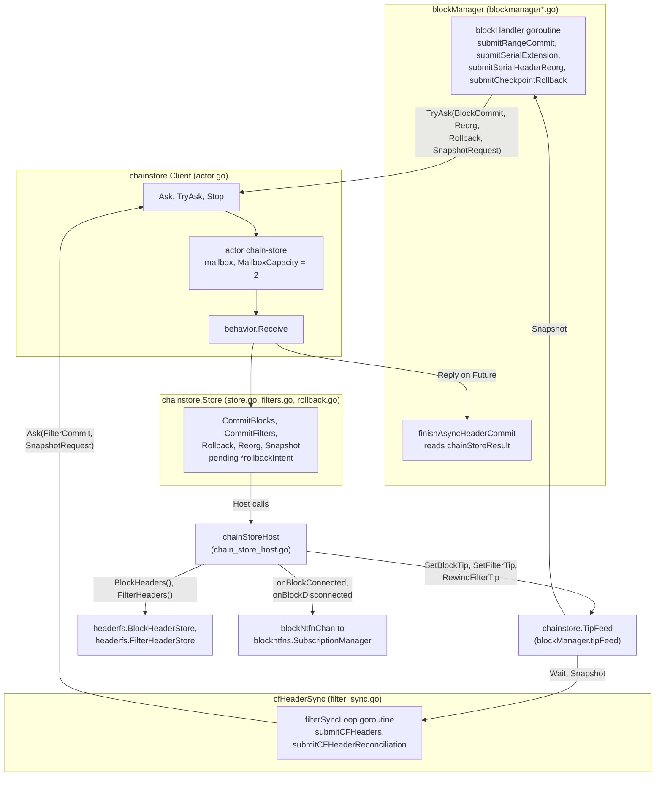
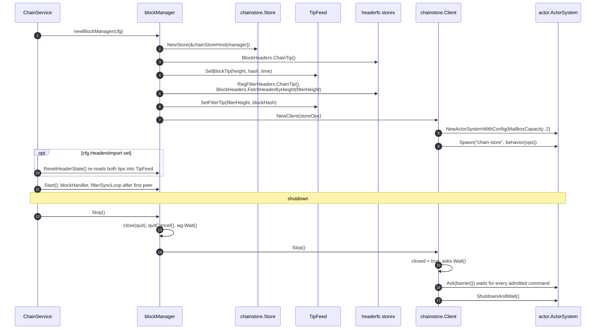
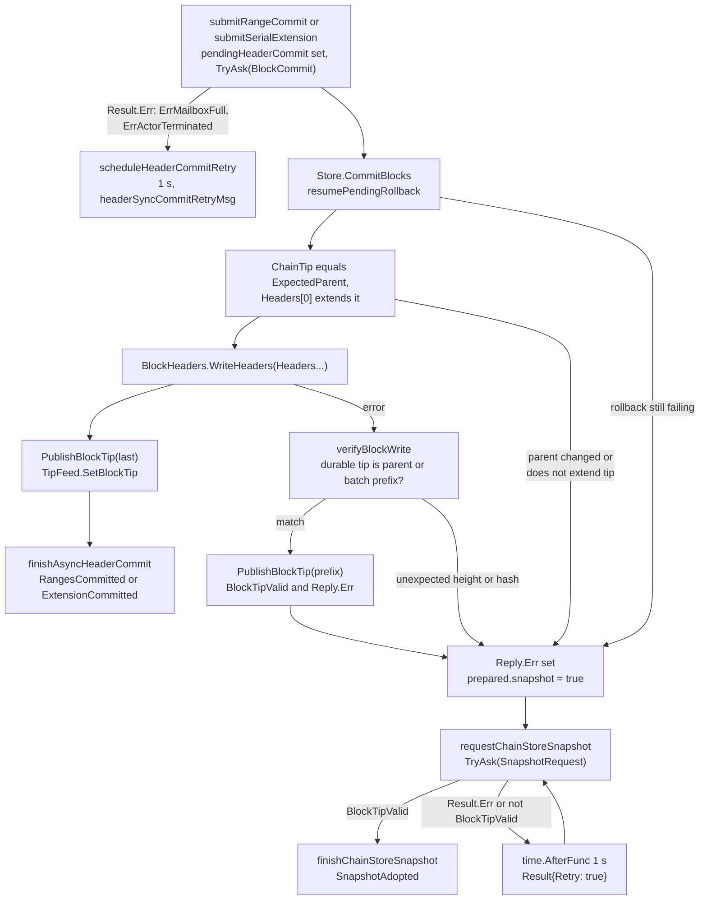
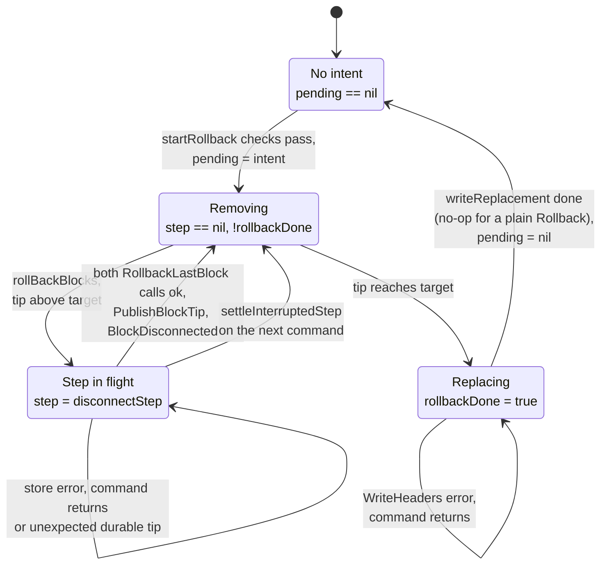
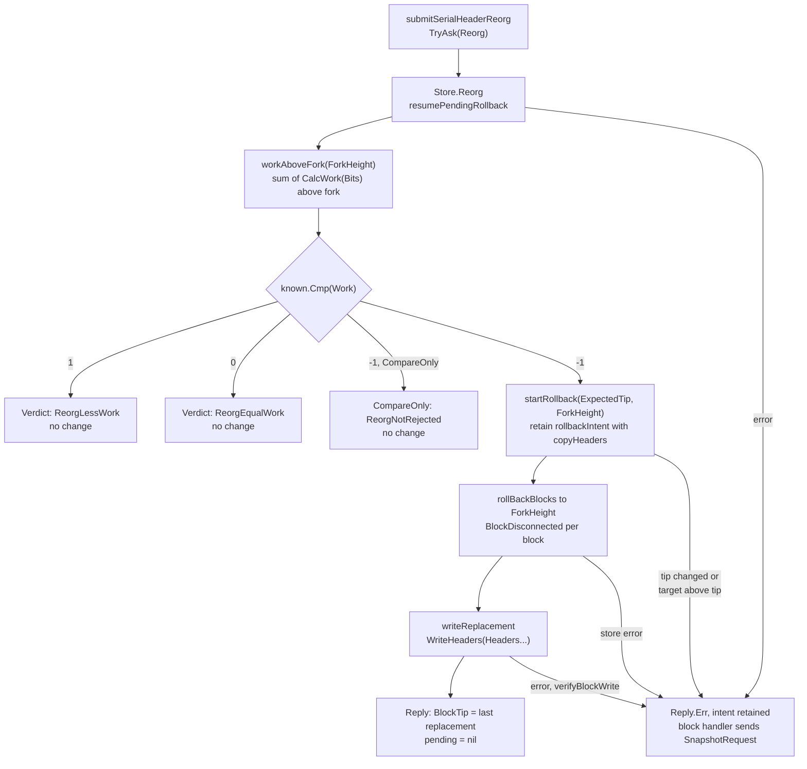
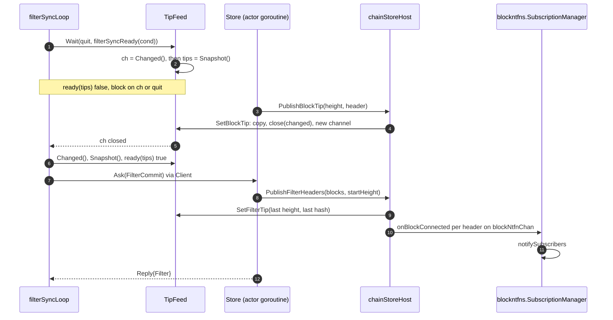

# Chain Store Architecture

The `chainstore` package keeps the block header store and the filter header
store in step with each other while two handlers write to them. Every mutation
of either store goes through one actor, which checks each command against the
durable tips on its own turn, verifies what landed when a write fails, and
only then publishes the result to the tip feed and to block notification
subscribers. This document describes who sends which command, what the actor
owns, and how a command moves from submission to a durable, published result.
It reflects the code at commit `485033b` (branch
`roasbeef/headersync-driver-fsm`, PR #446).

For the cross-package picture (header sync, filter header sync, the query
work manager) and the SQL schema of the header tables, see
[sync-architecture.md](sync-architecture.md). This document uses the same
terms: the *chain store actor*, the *tip feed*, the *durable tip* (what
`ChainTip` returns from a store), and the *published tip* (what the tip feed
holds).

## Components

The package has four parts. `Client` (`actor.go`) admits commands into an
`lnd/actor` mailbox (`github.com/lightningnetwork/lnd/actor` v0.0.8).
`Store` (`store.go`, `filters.go`, `rollback.go`) runs each command on the
actor goroutine. `Host` (`store.go`) is the interface `Store` calls to read the
header stores and to publish, and `chainStoreHost` in the root package
implements it on top of the block manager. `TipFeed` (`feed.go`) holds the
published tips and wakes goroutines that wait on them.

Commands enter only through `Client`, and `Store` touches the outside world
only through `Host`. The block handler submits without waiting (`TryAsk`) and
reads the reply later from `chainStoreResult`, because it has to keep serving
peers while a write runs. The filter handler submits with `Ask` and blocks
until the reply arrives, since nothing else runs on its goroutine. Both read
the published tips from the tip feed, never from the actor.

### Responsibilities

| Package or type | Owns | Does not own |
| --- | --- | --- |
| `chainstore.Client` | The actor system and the `chain-store` actor, admission (`closed`, the `asks` WaitGroup), the drain on `Stop`, the `rejected` counter | What a command does, and the stores |
| `chainstore.Store` | The order and checks of every write to both header stores, the retained rollback (`pending`), verification of ambiguous writes, the decision of what to publish and when | The published tips (written through `Host`), header validation, sync policy, the notification channel |
| `chainStoreHost` | The mapping from `Host` calls to `blockManager` state: `cfg.BlockHeaders`, `cfg.RegFilterHeaders`, `tipFeed`, `onBlockConnected`, `onBlockDisconnected` | Any decision; it runs on the actor goroutine and does what `Store` asks |
| `chainstore.TipFeed` | The published `Tips` (block height, hash, time; filter height and the block hash at that height) and the change channel | Durability; it holds only what `Store` has already verified |
| `blockManager` (`blockHandler`) | `pendingHeaderCommit`, the commit retry timer, the reaction to each reply through the headersync driver | Store writes, which it submits as commands |
| `cfHeaderSync` (`filterSyncLoop`) | Filter header download and verification against checkpoints | Filter header writes and the binding of a batch to its blocks, which `Store.CommitFilters` does |

## Message catalog

`Message` is a sealed interface (`messages.go`): only the types in that file
implement `chainStoreCommand`. Every command is an ask, and every reply is a
`Reply`. There are no tells. `behavior.Receive` (`actor.go`) dispatches on the
type, and it always returns `fn.Ok(reply)` for a known command, with the
command's error carried in `Reply.Err`. The actor's own error result is used
only for an unknown command type.

| Command | Sender | `Store` method | Checks before any write | Reply on success |
| --- | --- | --- | --- | --- |
| `BlockCommit{ExpectedParent, Headers}` | `submitRangeCommit` (parallel ranges), `submitSerialExtension` (serial batch), both `TryAsk` | `CommitBlocks` | Batch is non-empty; durable tip equals `ExpectedParent`; first header is at tip height + 1 and its `PrevBlock` is the tip hash | `BlockTip` = last header, `BlockTipValid` |
| `Rollback{ExpectedTip, Height}` | `submitCheckpointRollback`, `TryAsk` | `Rollback` | Durable tip equals `ExpectedTip`; `Height` is at or below the tip | `BlockTip` = header at `Height`, `BlockTipValid` |
| `Reorg{ExpectedTip, ForkHeight, Headers, Work, CompareOnly}` | `submitSerialHeaderReorg`, `TryAsk` | `Reorg` | `Work` beats the durable work above `ForkHeight`; then the `Rollback` checks against `ExpectedTip` | `Verdict`; on a winning reorg, `BlockTip` = last replacement header |
| `FilterCommit{Messages}` | `submitCFHeaders`, `Ask` | `CommitFilters` | `Messages[0].PrevFilterHeader` is the durable filter tip; messages chain to each other; the last `StopHash` is on the block chain | `Filter.FilterTip`, `Filter.FilterHeight` |
| `SnapshotRequest` | `requestChainStoreSnapshot` (`TryAsk`), `submitCFHeaderReconciliation` (`Ask`) | `Snapshot` | None | `BlockTip`, `BlockHeader`, `BlockTipValid`, and a `FilterSnapshot` |
| `barrier` (unexported) | `Client.Stop`, `Ask` | none | None | empty `Reply` |

Every `Store` method begins with `resumePendingRollback`, so a retained
rollback finishes before any other command reads or extends the chain. The
expected-tip fields (`ExpectedParent`, `ExpectedTip`) exist because the sender
prepared the command against a tip it read earlier, outside the actor. The
actor refuses the command if the durable tip has moved since, with
`block header parent changed` or `block header tip changed`.

`FilterSnapshot` is the filter side of a snapshot: the durable filter tip and
height, the durable block tip, and the stop block for the next `getcfheaders`
query. `Store.filterSnapshot` sets the stop block to the block tip, or to the
block `wire.MaxCFHeadersPerMsg` (2,000) headers past the filter tip when the
filter tip is further behind than that.

`Result` (`messages.go`) wraps a `Reply` for the block handler's
`chainStoreResult` channel. `Result.Err` is set when the command never reached
the actor or the wait ended early, and `Result.Retry` marks a timer wakeup
rather than a reply.

## Lifecycle

The chain store actor exists from `newBlockManager` until `blockManager.Stop`,
whether or not the handlers run.

The tip feed is seeded from the stores before either handler starts, so the
first `Snapshot` a handler takes matches the durable tips.
`ResetHeaderState` writes the tip feed directly rather than through the actor,
which is safe because it runs before `Start`, when no command can be in the
mailbox. The shutdown order matters for one reason: `Store` can be parked
inside `onBlockConnected` or `onBlockDisconnected`, which send on the
unbuffered `blockNtfnChan` until it is read or `quit` closes. Closing `quit`
first lets that send return, so the barrier can get its turn.
`ChainService.Stop` closes the SQL backend only after `blockManager.Stop`
returns, so every admitted command has finished before the stores close.

## Commit flow

A block header commit starts in the headersync driver, which returns a
`SubmitRangeCommit` or `CommitExtension` effect to the block manager executor
(`blockmanager_driver.go`). The executor records the command in
`pendingHeaderCommit` and submits it with `TryAsk`. The flowchart follows a
`BlockCommit` from there to a durable, published tip.

The rule behind the failure branches is that any `Reply.Err` leaves the
block handler's view of the chain unknown, so it reconciles with a snapshot
before it does anything else.

1. **Submit.** The executor sets `pendingHeaderCommit` and calls
   `Client.TryAsk`, which never parks the block handler on mailbox admission.
   An `OnComplete` goroutine delivers the outcome to `chainStoreResult`, which
   has a buffer of one.
2. **Admit or refuse.** If the mailbox refuses the command, `Result.Err` is
   set and `finishAsyncHeaderCommit` treats the command as never run:
   staging is kept and `scheduleHeaderCommitRetry` arms a one-second
   `headerSyncCommitRetryMsg`. A refusal from a full mailbox also increments
   `Client.rejected`, which `MailboxCapacity` makes unreachable (see
   [Concurrency](#concurrency)).
3. **Resume and check.** `CommitBlocks` finishes any retained rollback, then
   compares the durable tip with `ExpectedParent`. The headersync driver
   validated the batch against that parent, so a moved tip voids the
   validation and the command is refused before any write.
4. **Write.** `WriteHeaders` appends the batch. On success, `CommitBlocks`
   publishes the last header and returns it as `BlockTip`.
5. **Verify an ambiguous write.** If `WriteHeaders` returns an error,
   `verifyBlockWrite` reads the durable tip. If it is the expected parent or
   the last header of some prefix of the batch, that tip is published and
   returned with `BlockTipValid` set, alongside the write error. Any other
   tip means the store holds headers that were not submitted, which is
   reported and never published.
6. **Reconcile.** `finishAsyncHeaderCommit` sees `Reply.Err`, marks the
   pending commit as waiting on a snapshot, and sends `SnapshotRequest`.
   `Store.Snapshot` finishes any retained rollback, reads and publishes the
   durable block tip, and reconciles the filter tip. The driver adopts the
   block tip through `SnapshotAdopted`. A failed snapshot is the one request
   that retries by itself, through a one-second `time.AfterFunc` that posts
   `Result{Retry: true}`.

### Filter header commits

`filterSyncLoop` sends a `FilterCommit` with `Ask` once it has a verified,
contiguous run of `cfheaders` messages. `Store.CommitFilters` binds the batch
to the block store on the actor, so a batch fetched before a reorg can't land
on blocks the reorg removed.

1. **Resume and reconcile.** `resumePendingRollback` runs first, then
   `reconcileFilterTip` publishes any filter headers that are durable but
   unpublished. For each such height it checks that the filter store returns
   the same header by height and by block hash, then calls
   `PublishFilterTip` and `BlockConnected`. A durable filter tip below the
   published one is an error.
2. **Chain.** `writeFilterHeaders` requires `Messages[0].PrevFilterHeader` to
   equal the durable filter tip, and `deriveFilterHeaders` computes each
   header as the double SHA-256 of the filter hash and the previous header,
   per BIP 157.
3. **Bind.** `FetchHeaderAncestors` walks back from the last `StopHash` on the
   block store. If the stop block is not on the durable block chain, the call fails
   and the batch is refused. Each filter header then gets its block hash and
   height, which the SQL store needs as the row key.
4. **Write and verify.** On a `WriteHeaders` error, `verifyFilterWrite` reads
   the durable filter tip, checks every entry up to it by height and by block
   hash, and returns how many landed. If any entry disagrees, nothing is
   published.
5. **Publish.** `PublishFilterHeaders` moves the published filter tip to the
   last durable header, then sends one `BlockConnected` per header in order.

## Rollback and the retained intent

A rollback is many store writes: for each block above the target, one
`FilterHeaderStore.RollbackLastBlock` (when the block has a filter header)
and one `BlockHeaderStore.RollbackLastBlock`. Any of them can fail, or apply
and then report failure. `startRollback` (`rollback.go`) runs every check
first, then stores a `rollbackIntent` in `Store.pending`. From that moment an
error means the rollback will be resumed by the next command, not that it was
abandoned.

`settleInterruptedStep` decides how far an interrupted removal got by reading
only the durable stores. A removal touches the filter store first and the
block store second, so it finds one of three states: neither store changed
(it clears the step and `rollBackBlocks` repeats it), the filter store is
below the block but the block is still there (it rewinds the published filter
tip and removes the block), or both are gone and only the publication was
lost. In the last two states it publishes the parent and sends the single
`BlockDisconnected` for the step. Any other durable tip means something
outside the rollback changed the chain; the intent is kept and the command
returns an error.

Three invariants hold over the whole machine. A filter header never outlives
its block, because the filter side is always removed first. Each disconnect
notification is sent exactly once, because `step` is set before either store
changes and cleared only after `BlockDisconnected` returns. The published
filter tip never sits above the durable one: `rollBackBlocks` calls
`RewindFilterTip` after each filter removal, and after a filter removal whose
outcome is unknown it calls `refreshFilterTip`, which lowers the published
tip to the durable one. `TipFeed.RewindFilterTip` only ever lowers the tip,
so filter headers that were durable but never published stay unpublished
until `reconcileFilterTip` checks them.

The intent lives in memory on `Store`, not on disk. A process that exits with
a retained rollback restarts at whatever durable tip the stores hold, which
is consistent (filter tip at or below block tip) but may sit part way down.

A plain `Rollback` comes from `submitCheckpointRollback`, which the driver
emits when a header fails a checkpoint. The reply carries the target header
as `BlockTip`, and the block handler reports `CheckpointRolledBack` to the
driver, which drops the peer that sent the failing header.

## Reorg flow

A reorg arrives as a fork on the serial path: `handleHeadersMsgWithPeers`
passes a `headers` message to the driver, which validates the branch and
returns a `CommitReorg` effect. `submitSerialHeaderReorg` turns it into one
`Reorg` command, so the rollback and the replacement branch run in one actor
turn and no filter commit can land between them.

The work precondition is what makes the command safe to prepare outside the
actor. `Reorg.Work` is the proof of work of the whole branch the peer sent,
which can extend past `Headers`. `workAboveFork` sums `blockchain.CalcWork`
over the durable headers above `ForkHeight`, walking back from the durable
tip on the actor's own turn, so no write can land between the comparison and
the rollback. The branch must have strictly more work: a tie keeps the
durable chain. A `CompareOnly` reorg, which the executor sends when the
branch failed a checkpoint (`effect.Mismatch != 0`), returns only the verdict
and never checks `ExpectedTip`.

The driver acts on the verdict in `handleReorgCommitted`
(`headersync/driver_serial.go`):

| Verdict and mismatch | Driver action |
| --- | --- |
| `ReorgLessWork`, or `ReorgEqualWork` with a checkpoint mismatch | `disconnectTipPeer`, then `restartSyncIfIdle` |
| `ReorgEqualWork`, no mismatch | `restartSyncIfIdle`; the peer is not penalized |
| `ReorgNotRejected` with a mismatch (from `CompareOnly`) | `planCheckpointRollback`, which leads to a `Rollback` command |
| `ReorgNotRejected`, no mismatch | The branch is adopted and its sender becomes the sync peer |

## TipFeed

`TipFeed` (`feed.go`) holds the published `Tips` and notifies waiters when
they change. It has a mutex that is held only while a value is copied, and a
`changed` channel that `updateLocked` closes and replaces on every update. No
goroutine waits on a `sync.Cond`, and no lock is held across a store write, so
reading the tips never waits on the actor.

`Wait` takes the change channel before the snapshot, so an update that lands
between the two still closes the channel it holds. It checks the condition
once before blocking, so a condition that already holds returns at once, even
after `quit` has closed. Because the channel is closed rather than sent on,
any number of goroutines can wait, and a waiter that is busy during an update
sees the new tips on its next call.

The subscribers of the tip feed are:

| Reader | Call | What it reads |
| --- | --- | --- |
| `cfHeaderSync.filterSyncLoop` | `Wait`, `Snapshot` | Both tips; it waits until the filter tip lags by `wire.CFCheckptInterval` (1,000) or headers are synced, or until the filter hash and block hash differ |
| `blockManager.BlockHeadersSynced` | `Snapshot` | Block height and time, against the last checkpoint, the sync peer, and the time source |
| `driverConfig().PublishedTip` | `Snapshot` | Block height, for the headersync driver |
| `blockManager.NotificationsSinceHeight` | `Snapshot` | Filter height, the upper bound of a notification backlog |
| `chainStoreHost.PublishedFilterHeight` | `Snapshot` | Filter height, for `reconcileFilterTip` on the actor |

Rescans do not read the tip feed or send commands. They read the durable
stores directly (`ChainService.BestBlock` takes the lower of the two
`ChainTip` heights) and receive connected and disconnected notifications
through `blockntfns` subscriptions, whose backlog is bounded by the published
filter tip. A block is reported as connected only after its filter header is
durable, and as disconnected only after it has left the block store.

## Storage boundary

`Store` reads and writes the header stores only through `Host.BlockHeaders()`
and `Host.FilterHeaders()`, which return `headerfs.BlockHeaderStore` and
`headerfs.FilterHeaderStore`. It uses `ChainTip`, `FetchHeader`,
`FetchHeaderByHeight`, `FetchHeaderAncestors`, `WriteHeaders`, and
`RollbackLastBlock`. Both backends implement those interfaces, and nothing in
`chainstore` depends on which one is in use.

| Interface | Legacy backend (`headerfs/store.go`) | SQL backend (`headerfs/sql_store.go`) |
| --- | --- | --- |
| `BlockHeaderStore` | `blockHeaderStore`: flat file plus bbolt index | `SQLBlockHeaderStore`: `block_headers` and `chain_tips` rows in one transaction |
| `FilterHeaderStore` | `filterHeaderStore`: flat file plus bbolt index | `SQLFilterHeaderStore`: `filter_headers` and `chain_tips` rows in one transaction |

Production deployments use the SQL backend on SQLite. The schema, the
transaction executors, the WAL settings and the block header read cache are
described in the [Storage](sync-architecture.md#storage) section of
sync-architecture.md.

The chain store does not assume either backend's write is all-or-nothing as
seen by the caller. A SQL transaction can commit and then return an error,
and a flat-file append can land before its index update fails. That is why
every write error is followed by a read of the durable tip
(`verifyBlockWrite`, `verifyFilterWrite`) and why only a verified tip is
published. The filter header rows are keyed by both height and block hash in
the SQL store, so `writeFilterHeaders` fills in both for every entry, and
verification reads each entry back both ways.

Reads outside the actor are not serialized with its writes. The filter
handler's `ReadBlockTip` effect, `handleNewPeerMsg`, and
`ChainService.BestBlock` call `ChainTip` on the stores directly, and each
store's own lock orders those reads against the actor's writes. A reader that
needs the published view, rather than whatever is durable at that instant,
reads the tip feed.

## Concurrency

The actor goroutine is the only writer of both header stores after
construction, and the only writer of the tip feed after the handlers start.

| Goroutine | Owns |
| --- | --- |
| `chain-store` actor | `Store` and `Store.pending`; every `WriteHeaders` and `RollbackLastBlock` call; every `Host` call, so every tip feed update and every block notification |
| `blockHandler` | `pendingHeaderCommit`, the commit retry timer, the reaction to each `Result`; at most one command outstanding |
| `filterSyncLoop` | Its `Ask`, which blocks it; at most one command outstanding |
| `OnComplete` goroutine, one per `TryAsk` | Delivering one `Result` to `chainStoreResult`, or dropping it when `quitCtx` ends |
| Any goroutine | `TipFeed.Snapshot`, `Changed`, `Wait`; each takes the feed mutex only to copy a value |

`MailboxCapacity` is 2 because there are exactly two clients and each has at
most one command outstanding. The block handler sets `pendingHeaderCommit`
before every `TryAsk`, stops reading `peerChan` and `timeoutChan` while it is
set, and passes `CommitPending` to the driver in its `View`, so the next
command waits for the reply. The filter handler blocks inside `Ask`. `TryAsk` therefore never finds the
mailbox full, which matters because a refused command loses the headers it
carries. During `Client.Stop`, the barrier takes the second slot: the filter
handler's ask has drained through `asks.Wait`, and the block handler's last
command, if any, is the only other entry. `Client.Rejected` counts refusals;
the DST harness (`chain_store_dst_test.go`) asserts that it stays zero, and
production code does not read it.

Timers never touch chain store state. The commit retry timer posts a
`headerSyncCommitRetryMsg` to `timerChan`, and the snapshot retry timer posts
`Result{Retry: true}` to `chainStoreResult`, each selecting on `quit`.

The actor can block on notifications. `onBlockConnected` and
`onBlockDisconnected` send on the unbuffered `blockNtfnChan` until
`blockntfns.SubscriptionManager` reads it or `quit` closes. A slow
subscription manager therefore delays the next command, and a shutdown that
does not close `quit` before `Client.Stop` never drains the mailbox.

A failed or abandoned wait does not mean the command did not apply. There are
three ways a caller can be wrong about this:

- **`Reply.Err` with progress.** A write can apply in full or in part and
  then report an error. `Reply.BlockTipValid` and `Reply.BlockTip` give the
  verified durable tip even when `Reply.Err` is set, and the caller must
  reconcile with a `SnapshotRequest` before trusting its own view.
- **A context error from `Client.Ask`.** `Ask` returns when the caller's
  context ends, but an admitted command stays in the mailbox and still runs.
  Both handlers pass `quitCtx`, which ends only at shutdown, and
  `Client.Stop` waits for the barrier, so the command finishes before the
  stores close.
- **A retained rollback.** Once `startRollback` has stored the intent, an
  error from `Rollback` or `Reorg` means the rollback is part done and will
  finish on the next command of any type, including a `FilterCommit` or a
  `SnapshotRequest`.

`Result.Err` from `TryAsk` is the one failure that does mean the command
never ran: the mailbox refused it or the actor had stopped, and the block
handler keeps its staged work and retries after one second.

## Known gaps

- The claim that production deployments use SQLite comes from the brief for
  this document; the code supports SQLite and PostgreSQL, and this document
  did not check a caller's configuration.
- Whether a flat-file `WriteHeaders` can actually leave a durable prefix was
  not tested. The document describes the verification the chain store does,
  not a measured failure mode of each backend.
- The headersync driver's side of each commit (`PrepareRangeHeaders`,
  `SubmitRangeCommit`, `CommitExtension`, `CommitReorg`) is covered only where it
  meets the chain store. See [headersync-architecture.md](headersync-architecture.md)
  for the driver, and [filtersync-architecture.md](filtersync-architecture.md)
  for the filter header loop.
- `filtersync.Syncer` decisions (when to send a `FilterCommit`, how a commit
  error is retried) are summarized, not traced.
- The tests in `chainstore/actor_test.go`, `chainstore/feed_test.go`, and the
  root-package `chain_store_*_test.go` files were read only to find callers;
  no test was run for this document.
