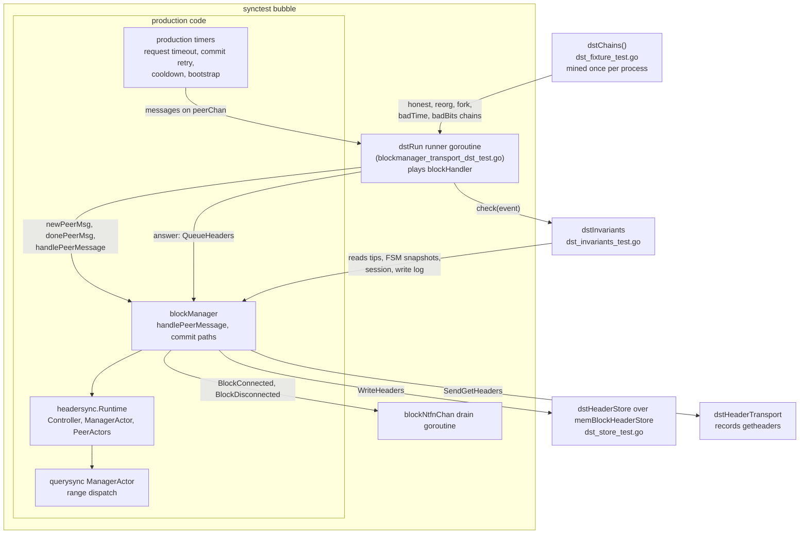
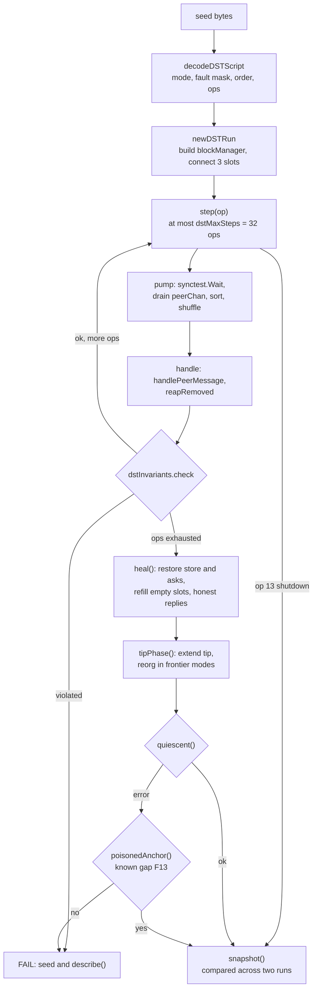
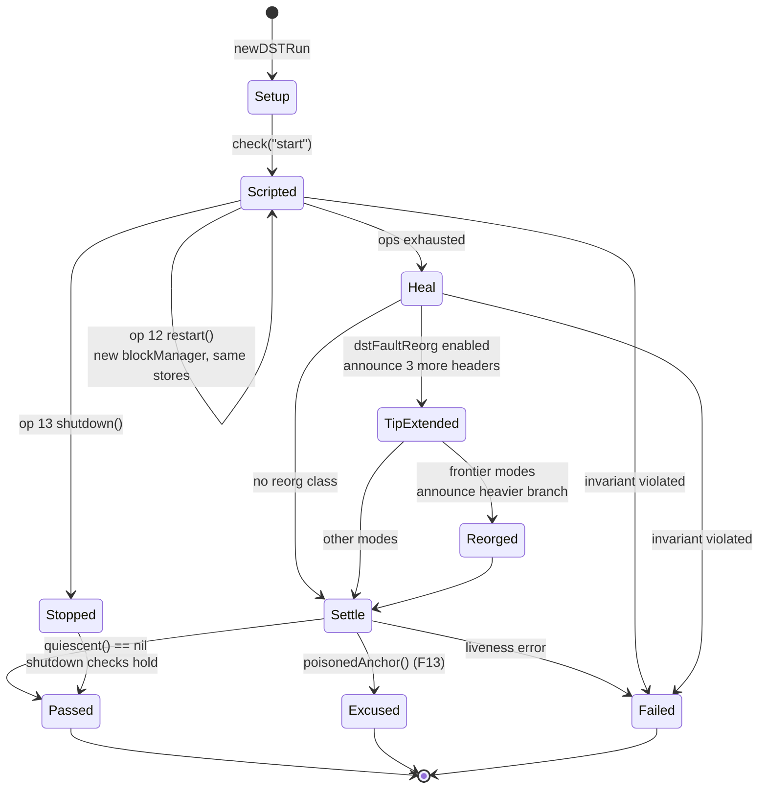
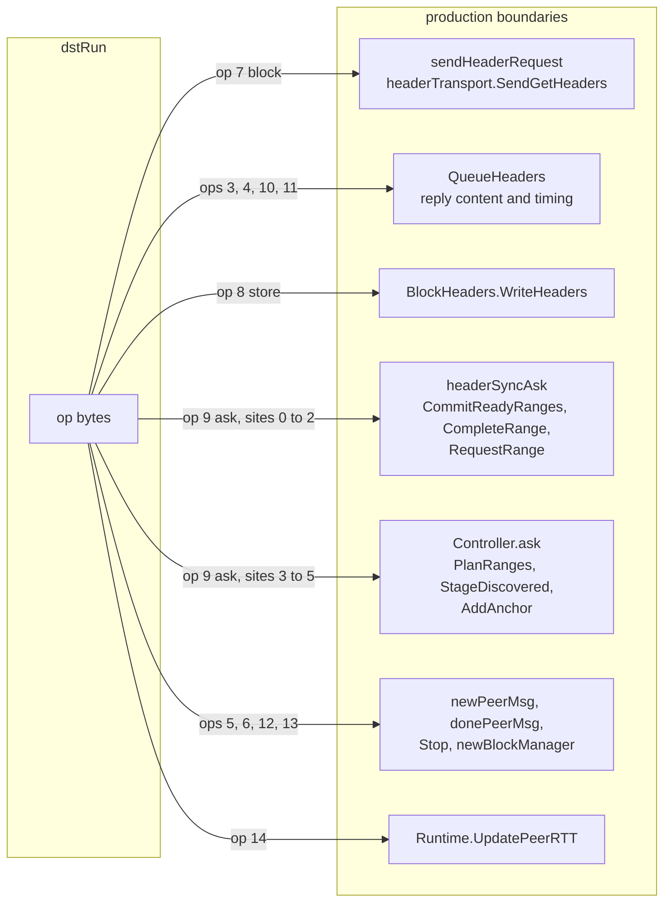
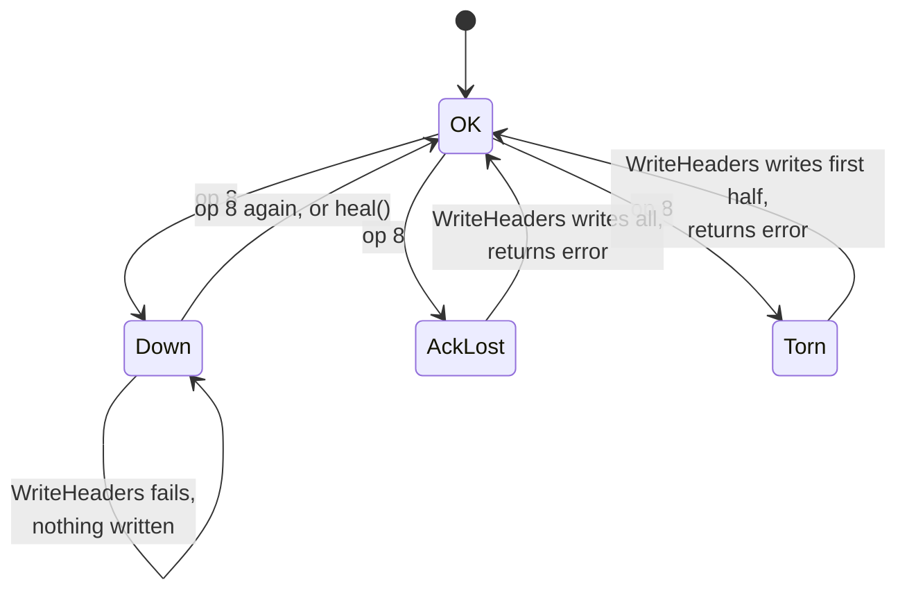
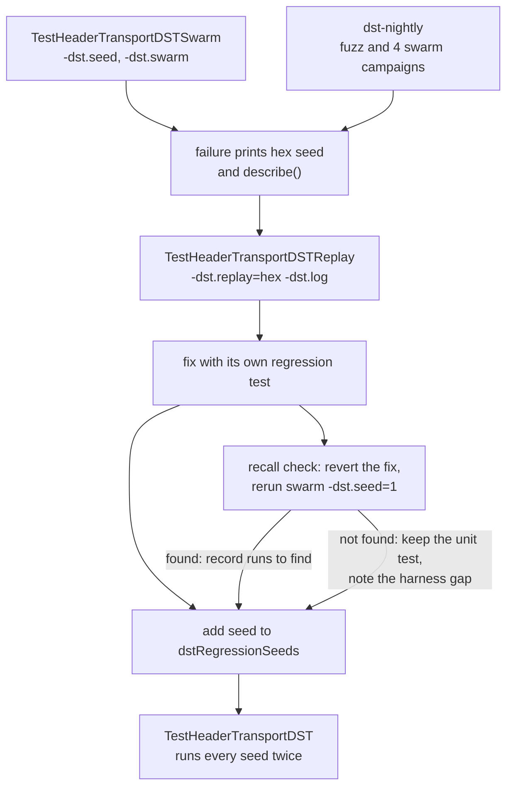

# Deterministic Sync Testing

Header sync is tested at four layers. Each catches a different class of bug,
and a pass at one layer does not imply a pass at another. This document
describes the header-sync deterministic simulation test (DST) in detail, and
the layers around it briefly. It reflects the harness at PR #415. For the
production code under test, see
[sync-architecture.md](sync-architecture.md).

| Layer | What runs for real | What is abstract | Entry point |
| --- | --- | --- | --- |
| P models | Nothing from Go; a model of the scheduler | Header contents, validation, storage | `p-models/scripts/check.sh` |
| FSM property test | `headersync.HeaderSyncFSM` | Actors, peers, blockManager, stores | `TestHeaderSyncFSMProperties` |
| Header-sync DST | blockManager message handling, headersync and querysync actors, production timers, contextual validation | Network (scripted peers), stores (in memory), time (virtual) | `TestHeaderTransportDST`, `TestHeaderTransportDSTSwarm` |
| Store tests | The SQL and flat-file stores | Everything above the store interface | `go test ./headerfs/... ./sqldb/...` |

## Run and replay

```sh
# Fixed corpus and every regression seed, each run twice for determinism.
go test . -run '^TestHeaderTransportDST$' -count=1

# A reproducible swarm campaign. -dst.seed picks the generator, -dst.swarm
# the number of seeds. A failure prints the seed and the run count.
go test . -run '^TestHeaderTransportDSTSwarm$' -dst.swarm=50000 -dst.seed=7

# Replay one seed, with block manager logs.
go test . -run '^TestHeaderTransportDSTReplay$' -dst.replay=<hex> -dst.log

# Coverage-guided fuzzing over the same runner.
go test . -run '^$' -fuzz '^FuzzHeaderTransportDST$' -fuzztime=10m

# Fixed scenarios, the exhaustive story test, and the FSM property test.
go test . -run '^TestHeaderTransport|^TestHeaderSyncDSTExhaustive$'
go test ./headersync/... ./querysync/... -count=1
```

`FuzzHeaderTransportDST` writes a failing input under
`testdata/fuzz/FuzzHeaderTransportDST`; replay it with
`go test . -run 'FuzzHeaderTransportDST/<file>'`. The fuzz body runs every
input once, and runs one input in sixteen a second time to compare the two
runs. `TestHeaderTransportDST` always runs each seed twice.

The `dst-nightly` workflow fuzzes for 20 minutes with a cached corpus, and
runs four swarm campaigns of 200,000 seeds each under a 40-minute timeout.
Each campaign's generator seed is `run_number * 16 + n` for `n` in 1 to 4, so
consecutive nights explore different seeds and any failure is reproducible
from the run number. The same workflow runs the P checker.

## Chain-store DST

`chain_store_dst_test.go` runs the real chain-store actor, `blockHandler` and
`cfHandler` through `blockManager.Start` in a synctest bubble. Unlike the
header-sync DST, no handler is driven by the runner. The harness supplies a
scripted header peer, a scripted cfheaders responder, a notification consumer
that can stall, and fault wrappers on both stores. Every store operation takes
virtual time, so a rollback and a filter batch commit can overlap.

After every event the oracle checks, against the durable stores, that the
block chain links, that each stored filter header is bound to the block the
block header store holds at that height, and that the delivered notifications
replay into a consistent chain. Where no actor turn can be in progress, it also
checks the published filter tip. The heal phase clears every fault, resumes the
consumer, and redelivers the heaviest chain until block tip, filter tip,
published tip and notified tip agree.

```sh
go test . -run '^TestChainStoreDST$' -count=1
go test . -run '^TestChainStoreDSTSwarm$' -dst.swarm=2000 -dst.seed=3
go test . -run '^TestChainStoreDSTReplay$' -dst.replay=<hex>
go test . -run '^$' -fuzz '^FuzzChainStoreDST$' -fuzztime=5m
```

## Harness components

The DST runs inside one `testing/synctest` bubble. Production code that
normally runs on its own goroutines runs there for real, and the harness
replaces only the network, the stores and the clock. The runner goroutine
also takes the place of `blockHandler`: `blockManager.Start` is never called,
and the runner calls `handlePeerMessage` itself.



Requests and replies take different routes on purpose. Production sends each
`getheaders` through the unexported `headerTransport` seam, where
`dstHeaderTransport` records it and returns. The runner later builds a reply,
encodes and decodes it as a wire message, and queues it through the
production `QueueHeaders` entry point. Production timers post their messages
to `peerChan` as usual. The runner drains that channel and handles the
messages one at a time, so all of blockManager's handler state stays on one
goroutine.

| Component | Runs for real | Simulated by the harness |
| --- | --- | --- |
| `blockManager` | `handlePeerMessage`, header validation, ordered commit, the serial path, reorg rollback, timers | Its event loop; the runner plays `blockHandler` |
| headersync and querysync actors | All of them, with production planning, leases, stealing and commit | Configuration: range cap and confirmation policy per mode |
| Peers | `ServerPeer` records, the new-peer and done-peer handlers | Three peer slots that reply from mined chains, honestly or not |
| Network | Wire encoding and decoding of every reply | Delivery: no sockets; replies go through `QueueHeaders` |
| Block header store | The `headerfs.BlockHeaderStore` contract, including contiguous writes and rollback | Storage: `memBlockHeaderStore` in memory, wrapped by `dstHeaderStore` for faults |
| Filter header store | The `headerfs.FilterHeaderStore` contract | Storage: `memFilterHeaderStore` in memory, with no faults |
| Time | Every production timer | The clock: virtual time inside the bubble |

### The chain fixture

`dstChains()` mines every chain once per process behind a `sync.Once`,
starting from the SimNet genesis header. The honest chain has 15 headers
above genesis at one-second spacing: `dstChainHeight` (12) is the sync target
and `dstTipExtra` (3) more are announced in the tip phase. The reorg chain
shares heights 0 to `dstReorgFork` (10) and then mines 6 headers at
three-second spacing, so it is heavier than the honest tip.

For every start height below 12 the fixture also mines three faulty chains:
a proof-of-work-valid fork, a chain whose first header carries the genesis
timestamp (not after median time past), and a chain whose first header uses
the harder difficulty `0x200fffff`. The fixture panics if any two mined
headers share a hash, because a collision would make a faulty reply look
honest. One run costs well under a millisecond of CPU.

## From seed to verdict

A seed is a byte string. The first three bytes configure the run and every
later byte is one operation. The same seed always produces the same run.



1. **Decode.** `decodeDSTScript` reads the mode from byte 0, the fault mask
   from bytes 1 and 2, and keeps up to 32 op bytes. The order seed is the
   SHA-256 of the op bytes, and it seeds the run's PCG generator. A seed
   shorter than three bytes runs in `checkpoint_all` mode with every fault
   class enabled.
2. **Set up.** `newDSTRun` builds the block manager over fresh in-memory
   stores, replaces its headersync runtime with one carrying the mode's
   configuration and the controller fault hook, and connects three peers. In
   `checkpoint_all` mode it plans all six ranges before the peers connect.
3. **Step.** `step` decodes one op byte as `op = value % 16` and
   `arg = value / 16`, and performs it (see the op table below). An op whose
   fault class is disabled performs an honest reply instead, so every seed
   keeps making progress.
4. **Pump.** `pump` waits until every goroutine in the bubble is blocked, then
   drains `peerChan`. Messages that arrived together are sorted by a stable
   key, such as the timeout's request ID or the peer address, and then
   shuffled with the run's generator. `synctest` makes the set of ready
   messages deterministic but not their order, so the seed chooses the order.
5. **Handle and check.** `handle` calls `handlePeerMessage`, waits for the
   bubble to settle, applies any disconnects production asked for, and runs
   the invariant checker. A violation fails the run immediately with the
   seed and a description of the peers, requests and timers.
6. **Heal and settle.** After the last op, `heal` removes every fault and
   drives the run to completion, the optional tip phase extends the chain,
   and `quiescent` checks liveness (see below).
7. **Compare.** `snapshot` records the events, steps, durable writes, bans,
   timeouts, notifications, and the final range and peer tables.
   `TestHeaderTransportDST` requires two runs of each seed to produce equal
   snapshots.

### Seed format

| Bytes | Meaning |
| --- | --- |
| 0 | Mode: `byte % 5` selects one of the five modes below. A byte whose low nibble is `0xf` selects serial mode instead. |
| 1 to 2 | Fault mask: little-endian `uint16`, one bit per fault class. |
| 3 onward | Ops, truncated to 32. |

| Mode | Planning | Purpose |
| --- | --- | --- |
| `checkpoint_all` | A checkpoint every two heights; all ranges planned before peers connect | Range dispatch, stealing and commit, with no discovery |
| `checkpoint` | The same checkpoints, started through production `startSync` | The production start path |
| `anchor` | One checkpoint at height 12 | Anchor discovery up to a trusted stop |
| `frontier1` | No checkpoints; one observation confirms an anchor (production policy) | Frontier discovery, as on mainnet past the last checkpoint |
| `frontier2` | No checkpoints; two matching observations per anchor | The stricter confirmation policy |
| serial | Checkpoints every two heights, SimNet network ID | The serial header path used on simnet and regtest |

The discovery modes cap ranges at `dstRangeCap` (4) headers, and simulated
peers honour the same cap, so the 12-header chain needs several spans. The
other modes use the wire limit of 2,000 headers. Every mode except serial
runs with the TestNet3 network ID, which puts production on the parallel
header path.

Re-encoding a regression seed's first byte to keep its mode is safe, because
byte 0 is used only to pick the mode. A new mode selector must not change
what existing seeds decode to; check the regression corpus when adding one.

### Operations

| Op | Fault class | Action |
| --- | --- | --- |
| 0, 1, 2 | always | Honest reply on slot 0, 1 or 2 |
| 3 | duplicate | Re-deliver the slot's last reply |
| 4 | stall (odd `sub` only) | Stall: reply on one slot, mark the others stalled, sleep 2 s. Otherwise sleep 1 to 16 ms |
| 5 | churn | Disconnect the slot's peer |
| 6 | churn | Connect a peer in an empty slot |
| 7 | block | Toggle blocked outbound sends for the slot's peer |
| 8 | store | Arm a store fault: down, ack lost, or torn; repeating a mode clears it |
| 9 | ask | Arm a one-shot actor ask fault, before or after apply, at one of six sites |
| 10, 11 | byzantine | Faulty reply: corrupt, partial, empty, overlong, reordered, fork, stale timestamp, wrong difficulty, gapped, or unsolicited |
| 12 | restart | Stop the block manager and rebuild it over the same stores |
| 13 | shutdown | Stop the block manager and end the run |
| 14 | rtt | Set the slot's RTT to 150 to 900 ms |
| 15 | always | Honest reply on every slot |

For ops that address a slot, `slot = arg % 3` and `sub = arg / 3`. In the
discovery modes a fork reply is sent as a stale-timestamp reply instead, so
forks are only served where checkpoints can reject them.

## Run phases



A restart keeps the stores, the transport and the invariant checker's view
of the durable tip, so recovery from the stored state is checked rather than
recovery from scratch. A shutdown ends the run early. After stopping, the
runner sleeps 6 s of virtual time and requires that no callback reached
`peerChan`, that no range is active, and that no commit retry is armed.

The heal phase removes faults without hiding the bugs they caused:

- **Faults off.** The store returns to normal, and pending ask faults and
  blocked sends are cleared.
- **Only empty slots are refilled.** A faulted peer that is still connected
  stays connected. Replacing it would run the done-peer reset, which restarts
  sync and would hide a stall the peer left behind.
- **Time keeps moving.** Each of at most 64 rounds sends an honest reply on
  every slot and sleeps: 500 ms after progress, 2 s while idle, and the
  2-minute peer cooldown after three idle rounds, so a quarantined peer can
  come back.

The tip phase runs when the reorg fault class is enabled. Peers announce
three more honest headers; in the two frontier modes they then announce the
heavier reorg branch forking at height 10. This drives the serial extension
path, `rollBackToHeight`, and the block notifications.

## Fault injection points

Every fault enters through a production boundary. No fault changes
production state directly.



The two ask seams model the same failure: an actor call that returns a
deadline error. `headerSyncAsk` wraps the three asks that blockManager makes,
through the unexported `blockManagerCfg.headerSyncAskFault` hook.
`Controller.ask` wraps the controller's own asks, through
`RuntimeConfig.AskFault`. Production leaves both hooks nil, and a nil hook
makes the wrapper call the ask directly. Each armed fault is one-shot:

- **Fail before.** The caller sees the deadline error and the actor is
  unchanged.
- **Fail after.** The actor applies the request, and the caller still sees
  the deadline error. This is the case production must recover from, because
  an ask timeout does not mean the actor's state is unchanged.

The store has four modes, and three of them fault the next write.



`dstStoreAckLost` and `dstStoreTorn` model an ambiguous commit: the write is durable, at
least in part, but production sees an error. `memBlockHeaderStore` accepts
only contiguous writes, like the SQL store, so a retry that rewrites a durable
height fails instead of passing silently. `dstHeaderStore` logs the height of
every header that becomes durable, and the invariant checker reads that log.

## Invariants

`dstInvariants.check` runs after every handled message, after every op, and
at the start, heal and tip-phase checkpoints. It is skipped once the block
manager is stopped.

| Check | Asserts |
| --- | --- |
| `durableChain` | The durable tip never decreases, except the serial path's rollback to the previous checkpoint. Every durable header is on the honest chain, or on the reorg chain after a reorg. The write log has no skipped heights, and no height is written twice unless a rollback removed it. |
| `memoryMatchesDisk` | The visible tip and the validation cache agree, and are on the chain. They trail the store only while a commit retry is armed to reconcile them. The next checkpoint is above the visible tip. |
| `rangeTable` | Each range has one owner, lease epochs never decrease, an owned or active range belongs to its peer, and committed ranges end at or below the durable tip. |
| `commitOnce` | No range is committed twice. |
| `leases` | A peer holding a lease has a wire request outstanding, and an active range owned by a ready or busy peer has a tracked request. |
| `honestImmunity` | A peer that never misbehaved or stalled is never quarantined, banned or disconnected, and no peer is ever IP-banned for being unresponsive. |

After the heal and tip phases, `quiescent` checks liveness. The durable tip
must have reached the target and the visible tip must equal it. No range or
anchor request may be active, no commit retry armed, and nothing staged.
Every range must be committed, failed or stale, or start at or above the
target.

Two known gaps are counted rather than failed, so the swarm keeps finding
other bugs. Both are policy decisions, tracked in
[#417](https://github.com/lightninglabs/neutrino/issues/417). Each excuse is
narrow, and anything outside it still fails:

- **F12.** When a peer answers anchor discovery with a lie first, the honest
  peer reporting the conflicting anchor is quarantined. Only a peer whose
  honest reply covered a liar's anchor or range stop is excused. Which
  reporter to punish is a policy decision.
- **F13.** Under the one-observation policy, a liar's discovery reply
  confirms its own boundary. If its payload is never staged, commit-time
  validation never runs, the anchor is never rejected, and honest replies for
  the span fail its stop hash. Only a run stuck exactly at the start of a
  range that ends at such an anchor is excused.

## Replay and recall

A failing seed becomes a permanent regression, and a fix is measured by
whether the generic swarm finds the bug without help.



The recall check is how harness changes are judged: revert one fix, run the
generic swarm with generator seed 1, and record how many runs it takes to
fail, with nothing in the harness specific to the bug. PR #415 lists the
recall table for the current fixes. A harness change that stops finding a recorded bug
is a regression in the harness.

## Other layers

`TestHeaderSyncFSMProperties` in `headersync/fsm_prop_test.go` drives
`HeaderSyncFSM` directly with `pgregory.net/rapid` state-machine actions:
peers join, leave and change state, and ranges are planned, assigned,
started, stolen, completed (validly, invalidly, or with a stale epoch),
committed, requeued and invalidated. After every action it checks the tip,
range ownership, lease epochs, non-overlapping live ranges, the commit order,
and that the FSM's counters match its tables.

The P header model, `tcHeaderSyncExplore` in
`p-models/neutrinoheadersync/test/header_sync_explore.p`, runs three peer
machines and an explorer that picks scheduler and peer events with `choose`.
Each peer sends bounded valid, invalid and stale replies. The
`HeaderSyncSafety` monitor checks a monotonic tip, single ownership and
ordered commits. `HeaderSyncLiveness` is a hot state from the start of
exploration until sync completes, so a schedule that never finishes fails.
Header contents and contextual validity are abstract inputs to P, and the
model treats storage as atomic; the DST covers both.

`TestHeaderSyncDSTExhaustive` runs a fixed recovery story through the
headersync actors over all 1,024 combinations of four fault flags, eight
latencies and eight deadlines. Querysync's JSON trace recorder preserves
nanosecond RTTs, so replays keep peer ordering when samples differ by less
than a millisecond. Those are Go scheduler traces, not P checker schedules.

## Known gaps

- **No cfheader DST.** The filter-header path, `cfHandler` and the query work
  manager are not driven. So the producer-side invariant is unchecked: after
  a reorg, every stored filter header's block hash must equal the block-header
  store's hash at that height. `rollBackToHeight` on `blockHandler` and
  `cfHandler` both write the filter-header store today. Tracked in
  [#416](https://github.com/lightninglabs/neutrino/issues/416).
- **Notification order is recorded, not asserted.** A connected notification
  for an old-fork block can reach subscribers after its disconnected
  notification.
- **SQL stores are a non-goal for the DST.** In-memory stores keep a run
  under a millisecond, which is what makes swarm campaigns of hundreds of
  thousands of seeds practical. The SQL stores implement the same contract,
  including contiguous writes, and their rollback and ambiguous-commit
  behaviour is covered by their own tests.
- **P scenarios are not derived from DST traces**, and the query model has no
  exploration test.
