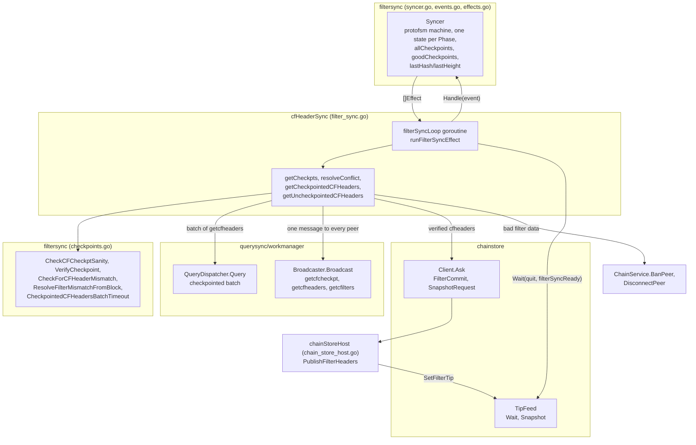
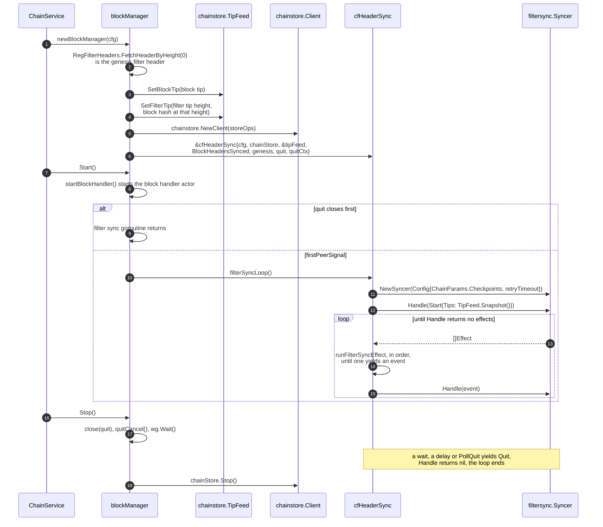
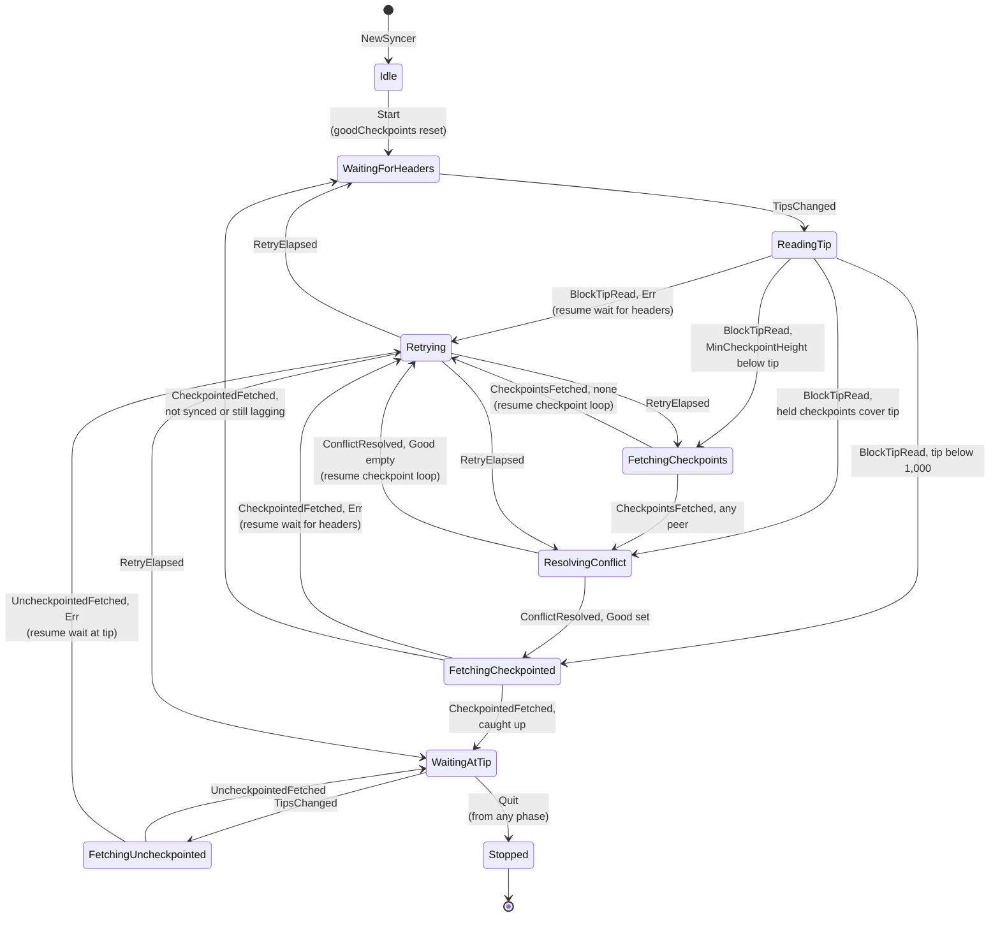
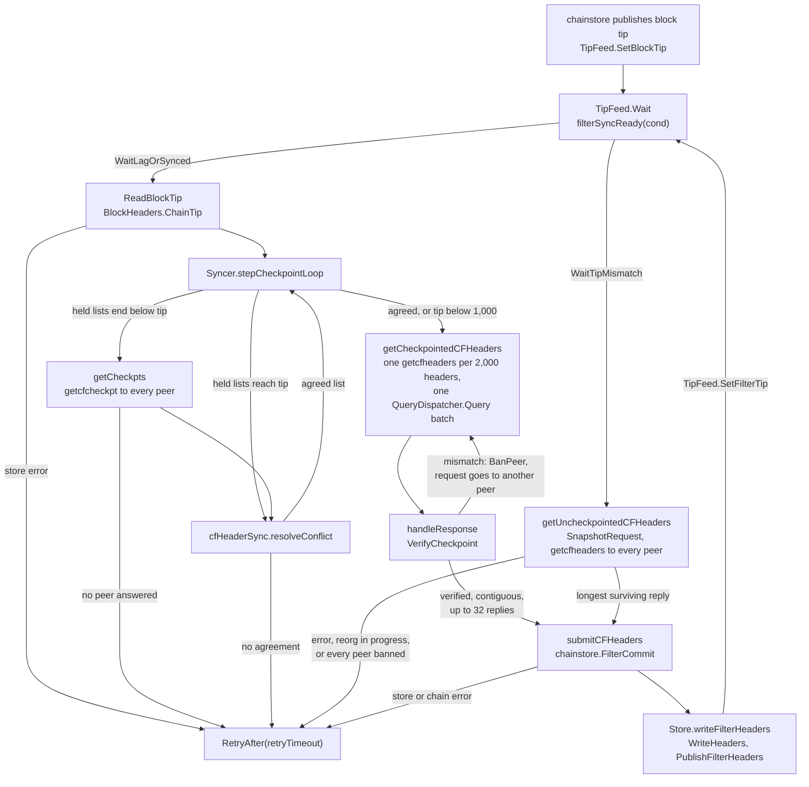
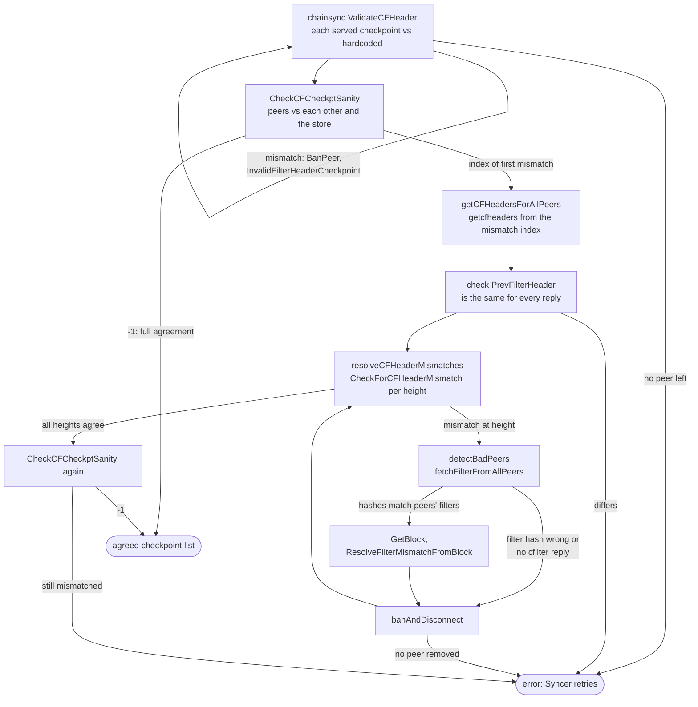

# Filter Header Sync Architecture

Neutrino keeps its regular (BIP 158) filter header chain in step with the
block header chain, using filter headers that its peers serve and that it
checks against checkpoints, against each other, and, when they disagree,
against the filters and the block itself. This document describes the
`filtersync` package, which decides what filter header sync does next, and
the `cfHeaderSync` executor in `filter_sync.go`, which performs those
decisions on the network and submits the results to the chain store. It
reflects the code at commit `485033b` (the tip of the sync series ending in
#446).

The cross-package picture, including where filter header sync sits next to
block header sync and the query work manager, is in
[sync-architecture.md](sync-architecture.md#filter-header-sync). The chain
store actor that performs every filter header write is described in
[chainstore-architecture.md](chainstore-architecture.md), and block header
sync, which moves the tip that filter header sync follows, in
[headersync-architecture.md](headersync-architecture.md).

Three terms are used throughout. A _checkpoint_ is the filter header at a
height that is a multiple of `wire.CFCheckptInterval` (1,000), as served by a
peer in a `cfcheckpt` message or as hardcoded in `chainsync`. A _pass_ is one
trip of the `Syncer` from waiting on the block header tip to either the next
wait or the tip. A _round_ is one effect that performs network I/O, such as
fetching checkpoints from every peer.

## Components

The `Syncer` in `filtersync/syncer.go` is a pure state machine: it takes an
event and returns effects, and does no I/O, reads no clock, and starts no
goroutine. It wraps a `protofsm` machine that has one state type per `Phase`
(`idleState`, `waitingForHeadersState` and so on), with the `Syncer` as the
machine's environment. `cfHeaderSync.filterSyncLoop` owns the `Syncer` and performs each
effect on its own goroutine. The effects reach three neighbours: the
`chainstore.TipFeed` for tip waits and snapshots, the query work manager for
network rounds, and the chain store actor for writes.

The split puts every decision about order in the `Syncer` and every check
on peer data in `checkpoints.go`, both free of I/O and tested without a
network (`syncer_test.go`, `bamboozle_unit_test.go`). The executor holds
the glue: it builds messages, waits for replies, bans peers, and turns each
outcome into the next event.

### Responsibilities

| Package or type | Owns | Does not own |
| --- | --- | --- |
| `filtersync.Syncer` | The `protofsm` machine whose current state is the phase (`Phase()` reads it from the state), the resume point after a retry (held by `retryingState`), the checkpoints each peer served (`allCheckpoints`), the agreed checkpoints for the current pass (`goodCheckpoints`), and the block header tip the pass syncs up to | Any I/O, timers, or goroutines; the stores; which peers are banned |
| `filtersync` checks (`checkpoints.go`) | Checkpoint agreement, checkpoint verification of a `cfheaders` reply, per-height mismatch detection, block-based reconciliation of disputed filters, and the batch timeout policy | Network access; banning; the store (except the reads in `CheckCFCheckptSanity`) |
| `cfHeaderSync` | The `filterSyncLoop` goroutine, every network round, banning and disconnecting peers that send bad filter data, and buffering out-of-order checkpointed replies | Block header sync; filter header writes and tip publication, which go through `chainstore`; the tip feed, which the `blockManager` owns |
| `chainstore.TipFeed` | The visible block and filter tips and the change channel | The durable stores; deciding when sync runs |
| `chainstore` actor | Binding each filter header batch to its blocks, the write, verifying a write that reported an error, and publishing what became durable | Peer data checks, retries, which peer served the headers |
| `chainStoreHost` | Moving the tip feed's filter tip and sending one `BlockConnected` per new filter header | Deciding what is durable, which the chain store decides |

## Lifecycle

`newBlockManager` builds the `cfHeaderSync` value, and `blockManager.Start`
runs its loop on a goroutine once the first peer connects. The filter tip is
seeded on the tip feed before the executor exists, so the first `Start`
event already carries the durable filter tip.

The order matters at shutdown: `Stop` cancels `quitCtx` before it waits, so a
pending `chainStore.Ask` from the loop returns at once, and it stops the
chain store only after `wg.Wait` returns, so the loop never submits to a
stopped actor.

## The Syncer state machine

`Syncer.Handle` takes one event, runs it through the machine and returns the
batch of effects the state emitted as its outbox. Each `Phase` is a state
type whose `ProcessEvent` names the one event it accepts; `Phase()` returns
the phase of the current state, and `Handle` and `Phase` are the only API the
loop uses. Every phase
but `PhaseIdle` and `PhaseStopped` waits for exactly one event type, and
`runFilterSyncEffect` yields exactly that type for the effect the phase
requested. An event that does not fit the phase is logged and dropped, and
the empty result ends the loop. `Quit` stops the `Syncer` from any phase.

The diagram draws one `Quit` edge, but every phase moves to `Stopped` on
`Quit`, and `Stopped` has no exit. `Retrying` is `retryingState{resume}`, and it leaves through the resume point
it carries: `resumeWaitForHeaders` starts a new pass, `resumeWaitAtTip`
goes back to waiting at the tip, and `resumeCheckpointLoop` reruns
`stepCheckpointLoop`. A retry in the checkpoint loop only happens with no
agreed list and a tip at or above 1,000, so it leads to a checkpoint fetch
or a resolution, never straight to the checkpointed fetch.

`stepCheckpointLoop` makes the one real decision in the machine. If the pass
already has agreed checkpoints, or the block tip is below
`wire.CFCheckptInterval`, it fetches the checkpointed headers (on simnet and
other short chains, every peer would serve zero checkpoints). Otherwise, if
the shortest checkpoint list it holds (`MinCheckpointHeight`) ends below the
block tip, it fetches checkpoints again. The fetch asks for checkpoints up to
the last hardcoded block checkpoint when that is past the tip, so the list
does not have to be fetched again each time the block header chain advances.
If the held lists already reach the tip, it resolves them as they are.

`allCheckpoints` survives across passes and `goodCheckpoints` does not.
`waitForHeaders` clears the agreed list at the start of every pass, so every
pass past the first checkpoint resolves again before it fetches headers, but it only fetches the
checkpoints again when the tip has moved past them. A consequence is that a
failed resolution retried through `resumeCheckpointLoop` resolves the same
served lists again unless the tip has moved, because `resolveConflict` in the
`Syncer` hands the executor a capped copy and the executor's removals do not
reach `allCheckpoints`.

### Events and effects

Each effect yields one event, except `PollQuit`, which yields `Quit` when the
quit channel is closed and nothing otherwise. The `Syncer` places `PollQuit`
first and the effect that always yields an event last, and the loop drops the
rest of a batch once an effect yields an event. The batches with a `PollQuit`
are the checkpoint fetch, the resolution, and the return to the tip after an
uncheckpointed fetch.

| Effect | Performed by | Yields | Notes |
| --- | --- | --- | --- |
| `WaitForTips{WaitLagOrSynced}` | `TipFeed.Wait` with `filterSyncReady` | `TipsChanged` or `Quit` | Holds when `FilterHeight + CFCheckptInterval <= BlockHeight`, or `BlockHeadersSynced` reports true |
| `WaitForTips{WaitTipMismatch}` | `TipFeed.Wait` with `filterSyncReady` | `TipsChanged` or `Quit` | Holds when `FilterHash != BlockHash` |
| `ReadBlockTip` | `BlockHeaders.ChainTip`, then `TipFeed.Snapshot` | `BlockTipRead` | A store error sets `Err` |
| `FetchCheckpoints` | `getCheckpts` | `CheckpointsFetched` | `ByPeer` is empty when no peer answered |
| `ResolveConflict` | `cfHeaderSync.resolveConflict` | `ConflictResolved` | May ban or disconnect peers |
| `FetchCheckpointed` | `getCheckpointedCFHeaders` | `CheckpointedFetched` | Reads `BlockHeadersSynced` and a tip snapshot after the fetch |
| `FetchUncheckpointed` | `getUncheckpointedCFHeaders` | `UncheckpointedFetched` | May ban or disconnect peers |
| `RetryAfter` | `time.After(Delay)` or `quit` | `RetryElapsed` or `Quit` | `Delay` is `retryTimeout`, 3 seconds |
| `PollQuit` | Non-blocking receive on `quit` | `Quit` or nothing | |

An effect the executor does not recognize yields `Quit`, so a new effect type
added to `filtersync` without a case in `runFilterSyncEffect` stops filter
header sync instead of spinning.

## Waiting on the header tip

Filter header sync follows the block header tip through
`chainstore.TipFeed`, not through messages from the `blockManager`. The chain
store publishes a block tip with `SetBlockTip` after each block header write
becomes durable, and a filter tip with `SetFilterTip` after each filter
header write. Each update closes the feed's change channel and replaces it.

`TipFeed.Wait` takes the change channel before it takes the snapshot, and
checks the condition before it blocks, so an update that lands between the
two still wakes it and a condition that already holds returns at once. The
feed is level-triggered in this sense: the loop compares the condition
against the current tips, not against a count of updates. A tip change that
lands while the loop is in a network round is seen by the next wait, which is
why the rounds may block `filterSyncLoop` for as long as they take.

The two wait conditions give the two regimes. During initial sync,
`WaitLagOrSynced` holds once the filter tip trails the block tip by at least
one checkpoint interval, so the checkpointed fetch always has at least one
interval to fetch, or once `blockManager.BlockHeadersSynced` reports the
block headers current. `BlockHeadersSynced` reads the tip feed, not the
store, so the check does not wait on a store write. At the tip,
`WaitTipMismatch` holds whenever the filter tip's block hash differs from the
block tip's hash. That covers a new block and a reorg, since a reorg changes
the block tip hash even when the height does not change.

## From a new header tip to a durable filter header

The flowchart starts at a block header write and ends when the filter
headers for those blocks are durable and published. The checkpointed path
runs during initial sync, and the uncheckpointed path runs at the tip.

1. **Wait.** The loop blocks in `TipFeed.Wait` until the phase's condition
   holds for the visible tips. A filter tip that lags by a checkpoint
   interval leads to the checkpointed path, and a filter tip hash that
   differs from the block tip hash at the tip leads to the uncheckpointed
   path.
2. **Read the tip.** `ReadBlockTip` reads the block header tip from the
   store, which fixes `lastHash` and `lastHeight` for the rest of the pass.
   The checkpoints are capped at this height, because the executor can only
   verify checkpoints for blocks it has headers for.
3. **Fetch checkpoints.** `getCheckpts` broadcasts one `getcfcheckpt` with
   the chosen stop hash through `Broadcaster.Broadcast` and keeps every
   `cfcheckpt` reply whose filter type and stop hash match. Each peer
   attempt waits up to `QueryTimeout` (10 seconds). A peer that does not
   answer is left out of the map.
4. **Resolve.** `cfHeaderSync.resolveConflict` returns the checkpoint list
   that every remaining peer and the store agree on, banning the peers it
   can prove wrong. The next section describes it.
5. **Fetch checkpointed headers.** `getCheckpointedCFHeaders` starts at the
   checkpoint interval that holds the filter tip and builds one
   `getcfheaders` per `maxCFCheckptsPerQuery` intervals
   (`wire.MaxCFHeadersPerMsg / wire.CFCheckptInterval`, which is 2), so each
   request covers 2,000 headers and ends on a checkpoint. It submits them as
   one batch to `QueryDispatcher.Query`, which spreads the requests over the
   connected peers.
6. **Verify.** `checkpointedCFHeadersQuery.handleResponse` runs on a work
   manager worker goroutine for each reply. It matches the reply to its request
   by filter type and stop hash, then calls `VerifyCheckpoint`, which checks
   that `PrevFilterHeader` equals the checkpoint before the range and that
   the chained filter headers end on the checkpoint at the end of the range.
   The first range uses the genesis filter header as its previous
   checkpoint. A verified reply is sent on `headerChan` and marks the
   request finished.
7. **Order and commit.** Replies arrive out of order, so the loop keeps them
   in `queryResponses` keyed by checkpoint index and writes the run that
   starts at the current interval, at most `maxCFHeadersMsgsPerWriteBatch`
   (32) replies per `submitCFHeaders` call. The first reply is trimmed to
   start after the durable filter tip, since the store may already hold part
   of its range. `submitCFHeaders` sends a `chainstore.FilterCommit` and
   blocks on the reply. The checkpointed fetch ends when the current
   interval reaches the last agreed checkpoint.
8. **At the tip.** `getUncheckpointedCFHeaders` first sends a
   `SnapshotRequest`, which publishes any durable but unpublished filter
   headers and returns both tips plus a stop block at most
   `wire.MaxCFHeadersPerMsg` past the filter tip. It returns an error when
   the block height is below the filter height (a reorg in progress) and
   nothing when they are equal. Otherwise it broadcasts one `getcfheaders`
   and collects replies for `cfHeaderCollectTimeout` (2 seconds) or until
   every peer has answered, because an early agreement among fast peers is
   not proof against a slower peer's conflicting reply. It then drops and
   bans bad peers, settles per-height mismatches, and commits the longest
   surviving reply.
9. **Write and publish.** On the chain store actor, `writeFilterHeaders`
   checks that the batch chains from the durable filter tip, derives each
   filter header, and binds each one to its block by walking back from the
   stop hash with `FetchHeaderAncestors`. A batch whose stop block has left
   the chain fails this walk and is refused. After the write,
   `PublishFilterHeaders` moves the tip feed's filter tip and sends one
   `BlockConnected` per header. The filter tip update closes the change
   channel, which wakes the next `TipFeed.Wait`.

A `CheckpointedFetched` with no error does not end the pass on its own. The
`Syncer` reads the event's `HeadersSynced` and `Tips`: it starts a new pass if
the block headers are still syncing or the filter tip still lags by a
checkpoint interval, and waits at the tip otherwise.

## Checkpoint resolution and bad peers

Filter header sync bans a peer only when it can show that the peer's data is
wrong: against a hardcoded checkpoint, against an agreed checkpoint, against
the durable filter tip, against the peer's own filter, or against the block.
A peer that only fails to answer is disconnected without a ban.

`resolveConflict` runs these steps in order:

1. **Hardcoded checkpoints.** `chainsync.ValidateCFHeader` compares every
   served checkpoint with the hardcoded filter header checkpoints for the
   network. A peer with a mismatch is banned with
   `banman.InvalidFilterHeaderCheckpoint` and removed from the map.
2. **Agreement.** `CheckCFCheckptSanity` returns -1 when every peer agrees
   at every index up to the shortest list and the store agrees at every
   checkpoint height at or below its tip. Otherwise it returns the first
   index where a peer or the store differs. Peers whose list is shorter
   than that index are dropped from the map without a ban.
3. **Fetch the disputed headers.** `getCFHeadersForAllPeers` broadcasts one
   `getcfheaders` starting at the mismatched checkpoint height and stopping
   at the block tip or `wire.MaxCFHeadersPerMsg` headers later, whichever is
   lower. Only replies with the full expected count are kept. If the
   replies do not share one `PrevFilterHeader`, resolution fails and the
   `Syncer` retries.
4. **Settle each height.** `resolveCFHeaderMismatches` walks the heights.
   At each height where `CheckForCFHeaderMismatch` finds two different
   filter hashes, `detectBadPeers` fetches the filter at that block from
   every peer and classifies the peers, and `banAndDisconnect` acts on
   them. The same height is checked again until it agrees. If an iteration
   removes no peer, resolution fails with "filter header mismatch at
   height".
5. **Drop non-responders and recheck.** Peers that served checkpoints but
   did not answer the `getcfheaders` are disconnected without a ban. A
   second `CheckCFCheckptSanity` call returns the agreed list or fails with
   "got mismatched checkpoints".

`detectBadPeers` resolves the disputed block from the replies' common stop
hash with `FetchHeaderAncestors`, so a reorg cannot mix filter data from two
branches. It fetches the filter at that block from every peer with
`QueryTimeout` per attempt. A peer whose filter does not hash to its own
claimed filter hash is invalid. A peer that did not answer is unresponsive.
Only when every peer answered with a filter that matches its own headers does
it fetch the block and call `ResolveFilterMismatchFromBlock`, with a threshold
of `(len(filtersFromPeers)+2)/2`, a strict majority.

`ResolveFilterMismatchFromBlock` tries three checks in order. A filter that
fails `filtermatch.VerifyBasicBlockFilter` (it does not match an output
script or a derivable spent script) is invalid. Otherwise, the peers whose
filters match the most `OP_RETURN` scripts are invalid, provided at least the
threshold number of peers remain. Otherwise, the peers serving a filter other
than the most common one are invalid, provided the most common filter reaches
the threshold; if it does not, the function returns an error and the
resolution fails.

| Check | Where | Action | Ban reason |
| --- | --- | --- | --- |
| Served checkpoint differs from a hardcoded checkpoint | `resolveConflict`, `chainsync.ValidateCFHeader` | Ban | `InvalidFilterHeaderCheckpoint` (4) |
| Checkpointed reply does not chain between its checkpoints | `handleResponse`, `VerifyCheckpoint` | Ban; the work manager sends the request to another peer | `InvalidFilterHeaderCheckpoint` (4) |
| Uncheckpointed reply's `PrevFilterHeader` is not the durable filter tip | `getUncheckpointedCFHeaders` | Ban | `InvalidFilterHeader` (3) |
| Peer's filter does not hash to its own filter hash | `detectBadPeers` | Ban | `InvalidFilterHeader` (3) |
| Filter fails the block checks or is in the minority | `ResolveFilterMismatchFromBlock` | Ban | `InvalidFilterHeader` (3) |
| No `cfilter` reply during `detectBadPeers` | `detectBadPeers`, `banAndDisconnect` | Disconnect, no ban | none |
| Served checkpoints but no `cfheaders` reply during resolution | `resolveConflict` | Disconnect, no ban | none |
| Shorter checkpoint list than the mismatch index | `resolveConflict` | Dropped from this resolution only | none |

`ChainService.BanPeer` records the ban for `BanDuration` (24 hours) and
disconnects the peer. The ban reasons are defined in `banman/reason.go`.

## Query timeouts and retries

Every network round has a bound, and every failure the `Syncer` sees is
followed by `RetryAfter` with `retryTimeout` (3 seconds) before it continues
from the stored resume point.

| Round | Mechanism | Bound |
| --- | --- | --- |
| `getcfcheckpt` to every peer | `Broadcaster.Broadcast`, `Timeout(QueryTimeout)` | 10 seconds per peer attempt |
| `getcfheaders` to every peer (resolution and at the tip) | `Broadcaster.Broadcast`, `Timeout(cfHeaderCollectTimeout)` | 2 seconds per peer attempt |
| `getcfilters` to every peer in `detectBadPeers` | `Broadcaster.Broadcast`, `Timeout(QueryTimeout)` | 10 seconds per peer attempt |
| Checkpointed `getcfheaders` batch | `QueryDispatcher.Query` with `NoRetryMax`, `ProgressTimeout`, `Timeout` | 30 seconds without a completed request; a total of 250 ms per request, clamped to 2 to 15 minutes |

The broadcast timeout bounds how long each attempt waits on a peer, not the
broadcast as a whole. A broadcast returns when every peer has answered,
timed out, or disconnected.

The checkpointed batch has no cap on retries per request, so a request whose
reply failed `VerifyCheckpoint` goes back to the work manager and runs on
another peer. Two timers bound the batch instead. `ProgressTimeout(30 *
time.Second)` cancels the batch when no request completes for 30 seconds,
and `CheckpointedCFHeadersBatchTimeout` caps the total runtime at 250
milliseconds per request, at least 2 minutes and at most 15 minutes. The cap
keeps a peer that answers just inside the progress window from holding the
batch open for hours.

A batch that ends with an error, a timeout included, makes
`getCheckpointedCFHeaders` return nil after logging, with whatever contiguous
prefix it already committed left in the store. The `Syncer` then sees a
`CheckpointedFetched` with no error, finds the filter tip still lagging, and
starts a new pass that picks up from the new filter tip. Only a store or
chain store error, such as a failed block header read or a refused
`FilterCommit`, comes back as `Err` and goes through `RetryAfter`.

## Publishing the filter tip and notifications

The executor publishes nothing itself. The chain store actor publishes each
filter header write through `chainStoreHost.PublishFilterHeaders`, which moves
the tip feed's filter tip to the last written header and then sends one
`blockntfns.Connected` notification (`blockntfns.NewBlockConnected`) per header on `blockManager.blockNtfnChan`. A block
is therefore reported as connected only once its filter header is durable,
and the filter tip moves before the per-header notifications, so a reader of
the tip feed sees the new height first. The
[Notifications](sync-architecture.md#notifications) section of the overview
covers the subscription side.

A write that applies a prefix and then reports an error is checked by
`verifyFilterWrite`, and only the verified prefix is published. A durable
prefix that could not be verified at write time is published later by
`reconcileFilterTip`, which runs at the start of every `FilterCommit` and every
`SnapshotRequest`. `getCheckpointedCFHeaders` sends a `SnapshotRequest` when
there is nothing left to fetch, so a write that landed despite an error is
published before the pass ends.

## Concurrency

| Goroutine | Owns |
| --- | --- |
| `filterSyncLoop` | The `filtersync.Syncer`, its machine and all its state; the `checkpointedCFHeadersQuery` buffers (`queryResponses`, `stopHashes`) of the running batch; the response maps built inside each broadcast |
| Work manager dispatcher and workers | The checkpointed batch's jobs; `handleResponse` runs here and touches only `headerChan`, the read-only query fields, and `BanPeer` |
| Chain store actor | Every filter header store write and every filter tip publication, through `chainStoreHost` |
| Any goroutine | `TipFeed`, which takes its own mutex only to copy or replace a value |

The `Syncer` has no lock because `filterSyncLoop` is its only caller. The
effects run on the same goroutine, so a network round blocks the loop for its
whole duration, and nothing else sends to the loop while it does.
`filterSyncLoop` shares only the configuration, the chain store client, the
tip feed, `BlockHeadersSynced`, and the quit signals with the `blockManager`.

A broadcast's `HandleResp` closures write to a map local to the round
without a lock. The work manager calls a broadcast handler serially for one
broadcast, so the map has one writer at a time, and the round reads it only
after `Broadcast` returns.

`chainStore.Ask` takes `quitCtx` and no deadline. A filter header write
therefore blocks the loop until the actor replies or shutdown cancels the
context. `PublishFilterHeaders` blocks the actor on the unbuffered
`blockNtfnChan` for each header until the subscription manager receives it or
`quit` closes, so a stalled notification consumer stalls filter header writes
and, through them, `filterSyncLoop`.

An error from `chainStore.Ask` does not mean the write did not happen. The
actor may have applied the batch before shutdown cancelled the reply, and the
next `FilterCommit` or `SnapshotRequest` publishes whatever is durable.

## Known gaps

- No diagram covers the work manager's internals for the checkpointed batch
  (job heap, steal, cooldowns). The statement that a request whose reply
  failed `VerifyCheckpoint` runs again on another peer rests on `BanPeer`
  disconnecting the peer and on the work manager's documented requeue
  behaviour, not on a run.
- The repeated resolution of the same served checkpoint lists after a failed
  `ResolveConflict` (described in the state machine section) is read from
  the code, not observed in a test or a run.
- There is no deterministic simulation test for this path; see
  [deterministic-sync-testing.md](deterministic-sync-testing.md). The claims
  rest on reading the code and on the unit tests in `filtersync`.
- Only regular filters (`wire.GCSFilterRegular`) are synced. The `fType`
  plumbing in the effects has no second value in use.
