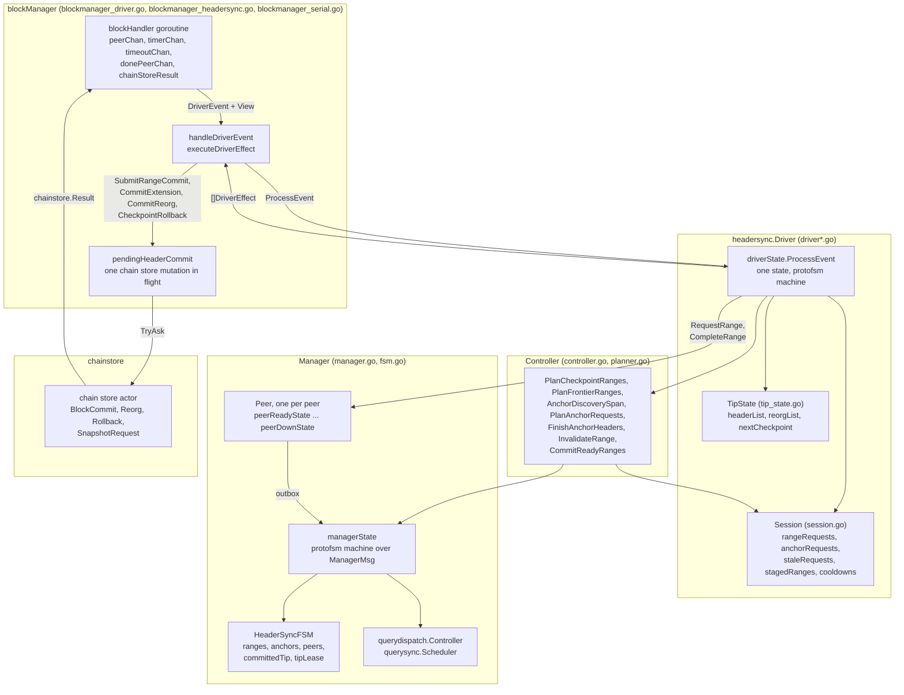
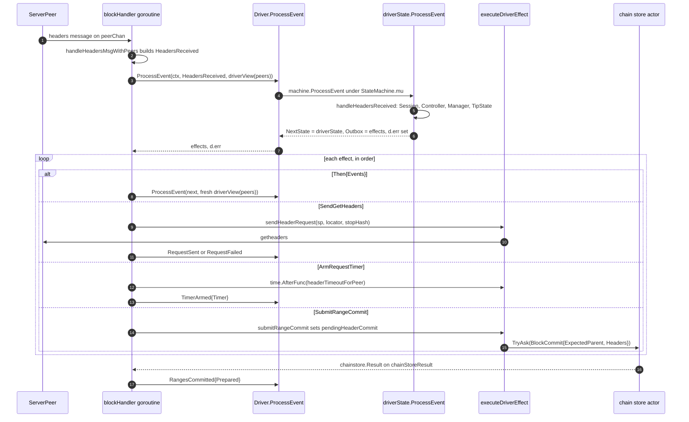
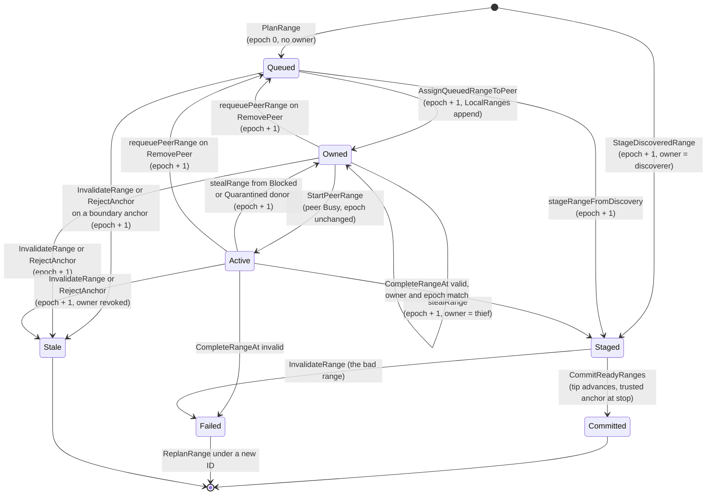
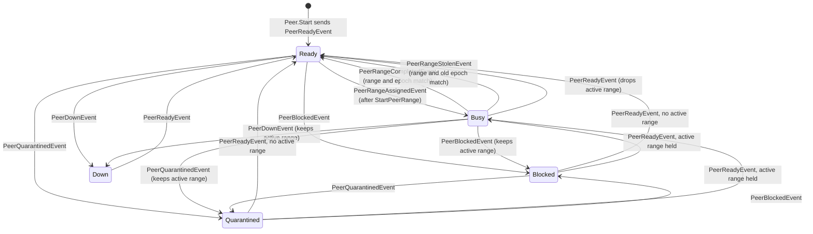
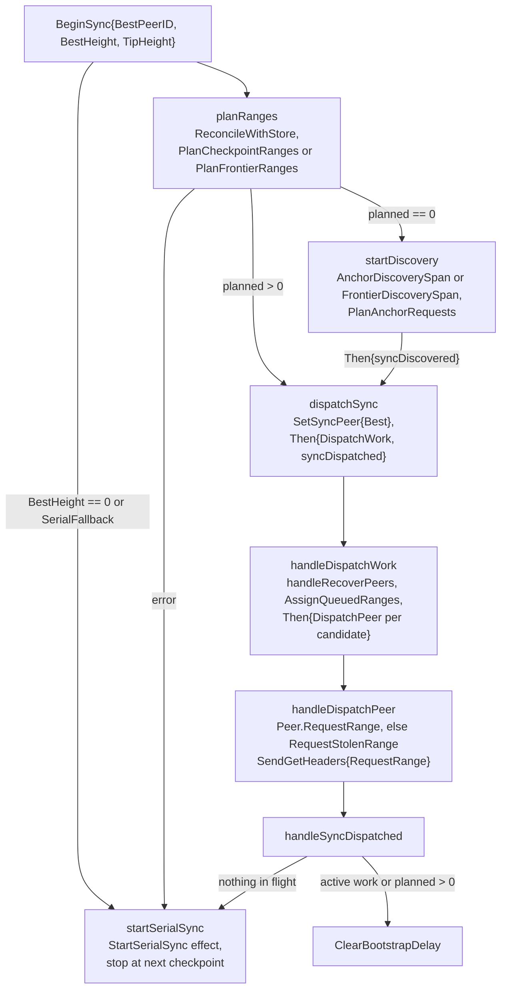
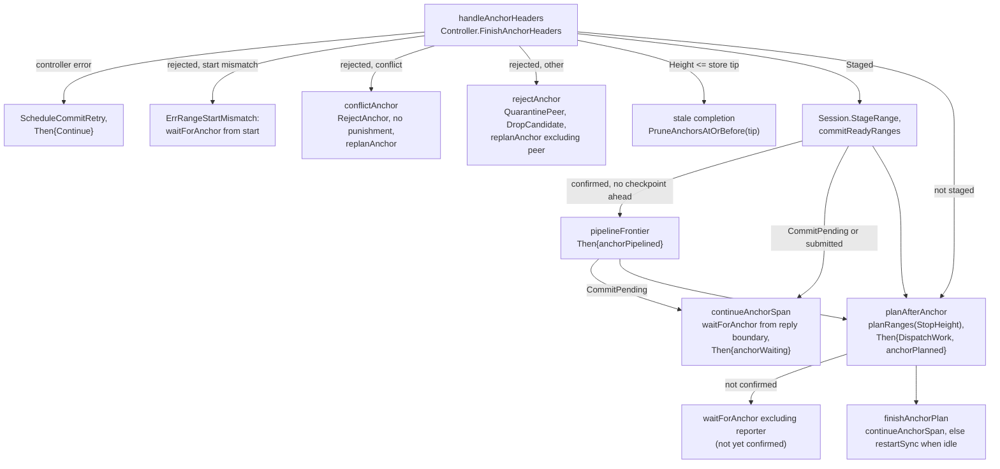
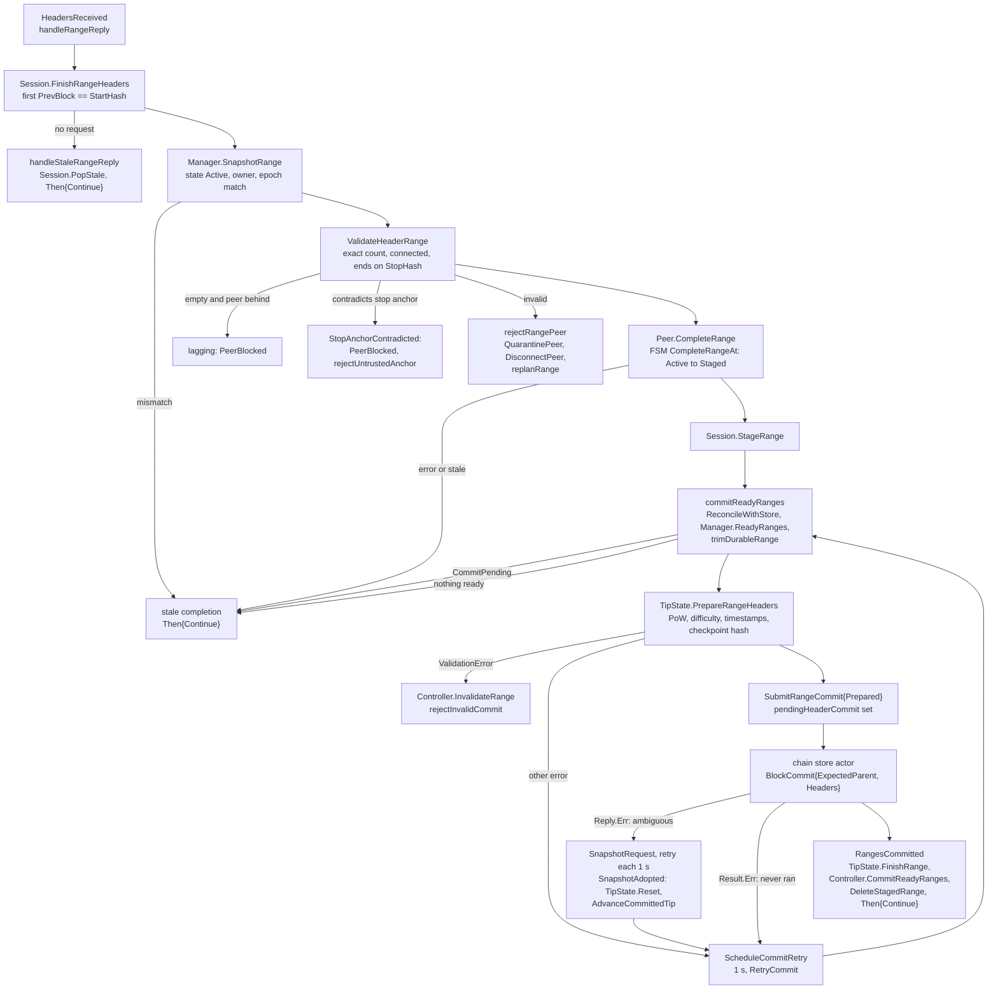
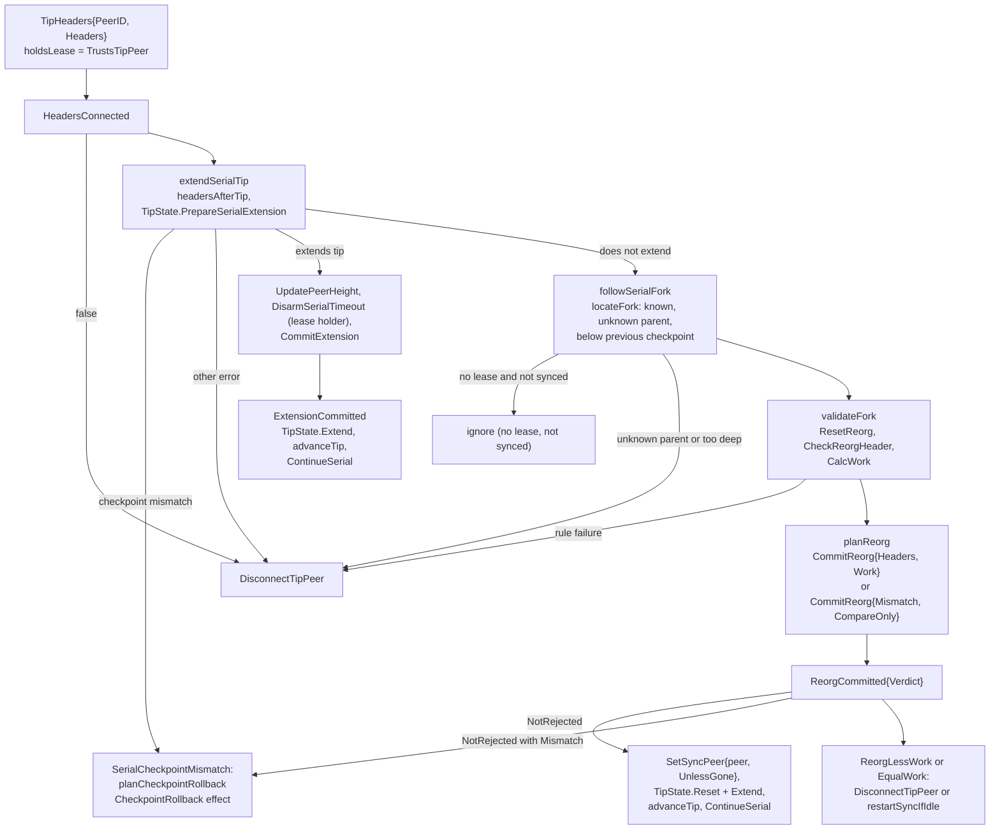

# Header Sync Driver Architecture

The `headersync` package decides what block headers to ask for, from whom,
and when a batch is ready to be written. This document describes the
package's internals: the `Driver` state machine and its executor in the
block manager, the `Manager` and the pure `HeaderSyncFSM` behind it, the
per-peer machines, the `Session` bookkeeping, the planner in `Controller`,
and the validation cache in `TipState`. It reflects the code at commit
`485033b` (PR #446, the tip of the driver FSM series).

For how header sync fits beside filter sync, the stores and the query work
manager, see [sync-architecture.md](sync-architecture.md). That document
defines the terms used here without restating them: a _range_ is the
half-open interval `(StartHeight, StopHeight]` between two confirmed anchors,
an _anchor_ is a height and hash the planner can use as a range boundary, a
_lease_ is the `LeaseEpoch` on a range that changes when its owner changes,
and a _checkpoint_ is a trusted anchor from the chain parameters. For the
deterministic simulation harness that exercises this code, see
[deterministic-sync-testing.md](deterministic-sync-testing.md).

## Components

`Driver` is the decision maker, and `blockManager` is its executor. The
driver takes one event, reads the world through a `View`, updates the
bookkeeping it owns, and returns a list of effects. The block handler
goroutine then performs those effects in order: it sends `getheaders`, arms
timers, submits writes to the chain store actor, and feeds the outcome of
each back to the driver as the next event. The driver's policy calls go
through `Controller`, which composes the `Manager` (range and anchor state)
and the `Session` (requests, timers, staged payloads).

The driver never calls the chain store, a peer, or a timer. Every arrow out
of `DR` toward the network or the disk is an effect that `blockManager`
performs. The arrow back from the chain store actor is a `chainstore.Result`
on the `chainStoreResult` channel, which the block handler turns into a
`RangesCommitted`, `ExtensionCommitted`, `ReorgCommitted`,
`CheckpointRolledBack` or `SnapshotAdopted` event.

### Responsibilities

| Type | Owns | Does not own |
| --- | --- | --- |
| `Driver` | The `TipState` validation cache, the request ID counter, the current `View` and the per-event error; the sequencing of controller, manager, peer and session calls within one event | A goroutine, timers, peer I/O, the chain store, the candidate peer list and the pending commit (all in `blockManager`); sync phases (none exist in the driver) |
| `driverState` | Nothing. It is an empty struct that dispatches on the event type and writes through the `*Driver` environment | Any data |
| `View` | A snapshot of `blockManager` state for one `ProcessEvent` call: `Peers` (the candidate list as `PeerCandidate` values) and `CommitPending` | Persistence across events; the executor rebuilds it per call |
| `blockManager` | The `blockHandler` goroutine, `candidatePeers`, `pendingHeaderCommit`, every `time.AfterFunc` timer, the serial sync peer, the `getheaders` wire send, and the chain store `TryAsk` | Range, anchor and lease state; validation |
| `Session` | In-flight `RangeRequest` and `AnchorRequest` per peer with their `*time.Timer`, `StaleRequest` entries, `StagedRange` payloads, peer cooldowns and `nextRangeID` | Range state (in `HeaderSyncFSM`); timer creation (the executor creates timers and the session only stops them) |
| `TipState` | `headerList` (the validation chain that trails the durable store), `reorgList` (scratch chain for a competing branch) and `nextCheckpoint`; contextual checks through `HeaderValidator` | Durable storage, which it reads through `TipConfig.BlockHeaders` and never writes |
| `Controller` | Planning and recovery policy: checkpoint and frontier ranges, discovery spans, hedged peer choice, anchor confirmation, invalidation fan-out, replanning | Any state of its own; peer punishment, which the driver emits as effects |
| `Manager` | A one-state protofsm machine over `ManagerMsg` that serializes every `HeaderSyncFSM` call and mirrors peer and range changes into `DispatchController` | Policy; goroutines; the tip lease methods, which bypass the machine |
| `HeaderSyncFSM` | `ranges`, `anchors`, `checkpoints`, `peers` snapshots, `committedTip`, `commitLog`, `metrics` and `tipLease` | Header payloads, timers, I/O |
| `Peer` | One protofsm machine per peer with the peer's RTT and active `RangeAssignment` | The authoritative lease, which the FSM's range table holds |
| `querydispatch.Controller` | The private `querysync.Scheduler` that picks range owners and steal donors; range IDs map one to one onto task IDs | Validation, leases, commit order |
| `Runtime` | Construction and shutdown of the manager, session, controller, driver and the `peers` map under `Runtime.mu` | Message routing; the driver calls each part directly |

## The driver loop

`Driver.ProcessEvent(ctx, event, view)` returns `[]DriverEffect`, the
machine's outbox. The executor runs the effects in order after the call
returns. Each effect that can fail or that produces a result reports back as
a further event, so the driver never waits inside a handler.

Five rules make this loop safe. The code documents each, and the executor
enforces none of them at runtime.

**A re-entering effect is the last effect of its batch.** `Then{Events}`,
`StartSync`, and any effect whose executor re-enters the driver (such as
`SendGetHeaders`, which reports `RequestSent`, or `SetSyncPeer`, which goes
through `setSyncPeer` and posts `FollowTip`) runs after the effects before
it. A nested `ProcessEvent` therefore sees the state those effects produced.
`handleSnapshotAdopted` emits `ScheduleCommitRetry` before the restart for
this reason. The driver never uses protofsm's `InternalEvent`; all re-entry
goes through the executor.

**Every `ProcessEvent` call gets a fresh `View`.** `handleDriverEvent` calls
`driverView(peers)` on every entry, including each event of a `Then`. The
view holds `Peers` (nil when the caller passed no list, as `PeerConnected`
and `FollowTip` do) and `CommitPending`, which is `pendingHeaderCommit !=
nil`. Because `DisconnectPeer` removes the peer from `candidatePeers` and
`SubmitRangeCommit` sets `pendingHeaderCommit` before the next event runs, a
follow-up event sees both. The view lives in the `Driver` environment rather
than in the event, so a replayed event cannot carry a stale one.

**The driver's error travels beside the effects.** `driverState.ProcessEvent`
stores the handler's error in `d.err` and always returns a nil transition
error. `Driver.ProcessEvent` returns `effects, d.err`. protofsm discards the
outbox when a transition fails, and the driver has already dealt with the
failure by logging it or scheduling a retry, so the effects it emitted must
still run. Only `PeerConnected`, `PeerDisconnected`, `PeerRTTUpdated`,
`PlanRanges` and `CommitReady` can set `d.err`, and only
`registerHeaderSyncPeer` reads the outcome's error; every other call site
discards it.

**A handler never calls `ProcessEvent`.** The machine's `StateMachine.mu` is
held for the whole call and is not reentrant, so a nested call would
deadlock. A handler that needs a follow-up emits `Then`. The executor's
re-entry is safe because it happens after the outer call returned.

**One commit at a time, and nothing reads peers while it is pending.** While
`pendingHeaderCommit` is set, `blockHandler` sets `peerChan` and
`timeoutChan` to nil in its `select`, so no reply or deadline reaches the
driver until the chain store answers. `donePeerChan`, `timerChan` and
`chainStoreResult` stay open. On the driver side, `resumeWork`,
`commitReadyRanges` and the anchor handlers check `view.CommitPending` and
defer anything that would read or move the tip.

Each `handleDriverEvent` call derives its context from `quitCtx` with
`headerSyncOpTimeout`, five seconds. The manager and peers run on the
caller's goroutine and do not check the deadline, so it bounds nothing in
practice; it exists so the `ask` path has a context to pass through.

## Events and effects

Events are the inputs to `driverState.ProcessEvent`. The table groups them
by who produces them. Types in lowercase are unexported and exist only as
`Then` follow-ups.

| Event | Source | Declared in | Handler |
| --- | --- | --- | --- |
| `HeadersReceived{PeerID, PeerHeight, Headers, HeadersSynced}` | Peer reply, built by `handleHeadersMsgWithPeers` | `driver_reply.go:16` | `handleHeadersReceived` |
| `RequestTimedOut{PeerID, Kind, RequestID, StartHeight, RangeID, LeaseEpoch, Timeout, StaleFor}` | Request timer via `handleHeaderSyncTimeoutMsg` | `driver_timeout.go:11` | `handleRequestTimedOut` |
| `SerialTimedOut{PeerID, StartHeight, Timeout}` | Serial deadline, only when `requestID` matches `serialRequestID` and the peer is the sync peer | `driver_timeout.go:143` | `handleSerialTimedOut` |
| `CooldownElapsed{SerialRequestPending}` | Cooldown wake timer (`headerSyncCooldownMsg`) | `driver_sync.go:55` | `handleCooldownElapsed` |
| `RetryCommit{}` | Commit retry timer (`headerSyncCommitRetryMsg`) | `driver_commit.go:28` | `handleRetryCommit` |
| `RequestSent{Request}`, `RequestFailed{Request, Err}` | Outcome of `SendGetHeaders` | `driver_dispatch.go:49`, `:57` | `handleRequestSent`, `handleRequestFailed` |
| `TimerArmed{PeerID, Kind, RequestID, Timer}` | Outcome of `ArmRequestTimer` | `driver_dispatch.go:66` | `handleTimerArmed` |
| `RangesCommitted{Prepared}` | Chain store result for `SubmitRangeCommit` | `driver_commit.go:34` | `handleRangesCommitted` |
| `ExtensionCommitted{PeerID, Extension}` | Chain store result for `CommitExtension` | `driver_serial.go:568` | `handleExtensionCommitted` |
| `ReorgCommitted{PeerID, Reorg, Nodes, Mismatch, Verdict}` | Chain store result for `CommitReorg` | `driver_serial.go:580` | `handleReorgCommitted` |
| `CheckpointRolledBack{PeerID, Node}` | Chain store result for `CheckpointRollback` | `driver_serial.go:603` | `handleCheckpointRolledBack` |
| `SnapshotAdopted{Node, CheckpointPeerID}` | `finishChainStoreSnapshot` after a failed mutation | `driver_serial.go:616` | `handleSnapshotAdopted` |
| `PeerConnected{Peer}` | `registerHeaderSyncPeer` from `handleNewPeerMsg` | `driver_peers.go:19` | `handlePeerConnected` |
| `PeerGone{PeerID}` | `handleDonePeerMsg` | `driver_peers.go:238` | `handlePeerGone` |
| `BeginSync{BestPeerID, BestHeight, TipHeight}` | `blockManager.startSync` after choosing the best peer | `driver_sync.go:15` | `handleBeginSync` |
| `Continue{}` | `handleNewPeerMsg` while a sync peer is set; also a `Then` follow-up | `driver_sync.go:34` | `resumeWork(startWhenIdle=true)` |
| `FollowTip{PeerID}` | `blockManager.setSyncPeer` | `driver_serial.go:46` | `handleFollowTip` |
| `ResumeWork{}`, `DispatchWork{}`, `DispatchPeer{PeerID}`, `CooldownWakeDue{}` | `Then` follow-ups | `driver_sync.go:42`, `:50`, `driver_dispatch.go:41`, `driver_peers.go:64` | `resumeWork(false)`, `handleDispatchWork`, `handleDispatchPeer`, `handleCooldownWakeDue` |
| `syncDiscovered`, `syncDispatched`, `continueDiscover`, `continueDiscovered` | `Then` follow-ups of sync start and resume | `driver_sync.go:112` to `:140` | `handleSyncDiscovered`, `handleSyncDispatched`, `handleContinueDiscover`, `handleContinueDiscovered` |
| `anchorPipelined`, `anchorPlanned`, `anchorWaiting`, `anchorReplanned`, `anchorTimedOut` | `Then` follow-ups of anchor discovery | `driver_anchor.go:25` to `:54`, `driver_timeout.go:47` | `handleAnchorPipelined`, `handleAnchorPlanned`, `handleAnchorWaiting`, `handleAnchorReplanned`, `handleAnchorTimedOut` |
| `PeerStateChanged`, `PeerDisconnected`, `PeerRTTUpdated`, `RecoverPeers`, `PeerDone`, `PlanRanges`, `CommitReady`, `TipHeaders` | Declared events with a `case` arm, but produced only by tests or called as plain functions from other handlers | `driver_peers.go`, `driver_dispatch.go:24`, `driver_commit.go:22`, `driver_serial.go:26` | As named |
| `AssignRanges{PeerCount}` | Declared at `driver_dispatch.go:32`; no `case` arm, so it is a no-op if sent as an event | | `handleAssignRanges` is called directly from `handleDispatchWork` |

Effects are the outbox. `executeDriverEffect` in `blockmanager_driver.go`
switches over every one; an unknown type is logged and dropped.

| Effect | Executor action | Declared in |
| --- | --- | --- |
| `Then{Events}` | Recursive `handleDriverEvent` per event, each with a fresh view | `driver_executor.go:75` |
| `StartSync{}` | `blockManager.startSync(peers)`, which may emit `BeginSync` | `driver_sync.go:79` |
| `SendGetHeaders{PeerID, Kind, Range, StartHeight, StartHash, StopHeight, StopHash}` | One-hash locator `[StartHash]`, `sendHeaderRequest`, then `RequestSent` or `RequestFailed` | `driver_dispatch.go:78` |
| `ArmRequestTimer{PeerID, Kind, RequestID, StartHeight, RangeID, LeaseEpoch}` | `armHeaderSyncRequestTimer` with `headerTimeoutForPeer`, then `TimerArmed` | `driver_dispatch.go:98` |
| `ArmCooldownWake{Until}` | `armHeaderCooldownWake`, a single timer, no-op if armed | `driver_peers.go:73` |
| `ScheduleCommitRetry{}`, `CancelCommitRetry{}` | One `time.Second` timer with a generation counter | `driver_reply.go:49`, `driver_commit.go:54` |
| `DisarmSerialTimeout{}` | `disarmHeaderSyncTimeout`, which bumps `serialRequestID` | `driver_serial.go:82` |
| `QuarantinePeer{PeerID}` | `cfg.QuarantinePeer` for `defaultHeaderPeerQueryQuarantine`, ten seconds | `driver_timeout.go:31` |
| `DisconnectPeer{PeerID}` | `removeSyncCandidate` and `sp.Disconnect()` | `driver_timeout.go:39` |
| `DropCandidate{PeerID}` | `removeSyncCandidate` only | `driver_anchor.go:16` |
| `DisconnectTipPeer{PeerID}` | `sp.Disconnect()` only | `driver_serial.go:61` |
| `UpdatePeerHeight{PeerID, Height}` | `sp.UpdateLastBlockHeight` | `driver_serial.go:70` |
| `SubmitRangeCommit{Prepared}` | `submitRangeCommit`: `pendingHeaderCommit.ranges`, `TryAsk(chainstore.BlockCommit)` | `driver_commit.go:45` |
| `CommitExtension{PeerID, Extension}` | `submitSerialExtension`: `pendingHeaderCommit.serial`, `TryAsk(chainstore.BlockCommit)` | `driver_serial.go:89` |
| `CommitReorg{PeerID, Reorg, Headers, Nodes, Work, Mismatch}` | `submitSerialHeaderReorg`: `TryAsk(chainstore.Reorg)`, `CompareOnly` when `Mismatch` is set | `driver_serial.go:103` |
| `CheckpointRollback{PeerID, Node, ExpectedTip}` | `submitCheckpointRollback`: `TryAsk(chainstore.Rollback)` | `driver_serial.go:131` |
| `SetSyncPeer{PeerID, UnlessGone}` | `setSyncPeer(nil)` for an empty ID, else `setSyncPeer(sp)`, skipped if `UnlessGone` and the peer disconnected; `setSyncPeer` posts `FollowTip` | `driver_sync.go:65` |
| `StartSerialSync{PeerID, StartHeight, StopHash, StopHeight}` | `blockManager.startSerialSync` | `driver_sync.go:86` |
| `ContinueSerial{PeerID, FinalHash, FinalHeight, StopHash}` | `finishSerialHeaderFollowup` | `driver_serial.go:631` |
| `NoProgressReply{PeerID}` | `handleNoProgressReply`; the only effect of its event because it can call `startSync` | `driver_reply.go:58` |
| `ClearBootstrapDelay{}` | `clearHeaderSyncBootstrapDelay` | `driver_sync.go:106` |

## Manager, FSM and peers

`Manager` is a `protofsm.StateMachine[ManagerMsg, managerOutbox, *managerEnv]`
with one state, `managerState` (`"headersync-manager"`). Every message runs
synchronously on the caller's goroutine through `Manager.ask`, transitions
back to `managerState{}`, and emits one response. There is no mailbox and no
deadline check. After `Stop`, or before `Start`, `ask` returns
`ErrActorStopped`. `SetTipLease`, `TrustsTipPeer` and `TipLease` call the FSM
directly and bypass the machine. The sync's phases live in the range states
and the peer machines, not in a top-level enum.

The range lifecycle is drawn in
[sync-architecture.md](sync-architecture.md#anchors-and-ranges) with the
manager-level names. The diagram below gives the same lifecycle with the
`HeaderSyncFSM` method that performs each transition, which is what a reader
of `fsm.go` sees.

`AdvanceCommittedTip` moves ranges without going through these arrows. A
forward move marks every range with `StopHeight <= tip` Committed and every
range that straddles the tip Stale, with no epoch change and no `commitLog`
entry. A rewind (`rewindCommittedTip`) deletes non-checkpoint anchors at or
above the new height and marks every range that stops above it Stale with an
epoch bump. Ranges are never deleted from `HeaderSyncFSM.ranges`; terminal
ranges stay in the map and `ReplanRange` allocates a new ID for the same span.

A stale completion is a `CompleteRangeAt` whose owner, epoch or Active state
does not match. It counts in `StaleCompletions` and changes nothing. The
driver checks the same three fields in `handleRangeReply` through
`SnapshotRange` before calling `CompleteRange`, so an honest peer whose lease
ended while its reply was in flight is not punished.

### Peer machines

Each `Peer` is a `protofsm.StateMachine[PeerMsg, peerOutbox, *peerEnv]`. Its
states carry the RTT and, when busy, the active `RangeAssignment`. Each
transition emits an outbox that `applyPeerOutbox` turns into a `Manager`
call, so the FSM's `PeerSnapshot` follows the machine.

The state names in the code are `peerReadyState`, `peerBusyState`,
`peerBlockedState`, `peerQuarantinedState` and `peerDownState`. Only Ready
starts work: `PeerNeedRangeEvent` in Ready emits `peerStartRangeOutbox`,
which calls `Manager.StartPeerRange` and then re-enters the machine with
`PeerRangeAssignedEvent`. In every other state the need events emit only a
snapshot. `PeerRangeCompletedEvent` and `PeerRangeStolenEvent` in Blocked,
Quarantined or Down clear the active range and keep the state. In
production, `PeerReadyEvent` after the initial one comes only from cooldown
recovery (`Runtime.UpdatePeerState(PeerReady)`), and `PeerDownEvent` has no
production sender.

The driver maps every state change through `setPeerState`, which records a
cooldown of `DefaultPeerCooldown` (two minutes) in the session for a Blocked
or Quarantined peer, emits `ArmCooldownWake` for the earliest expiry, and
calls `Runtime.UpdatePeerState`. `handleRecoverPeers` returns a peer to
Ready once its cooldown has expired and it holds no active request.

### Tip lease

`TipLease{PeerID, Epoch}` in `HeaderSyncFSM` names the one peer whose tip
headers the driver trusts before the node is synced. `SetTipLease` is a
no-op for the same holder and otherwise sets the holder and increments
`Epoch`; an empty ID releases it. The holder is always the executor's sync
peer: `blockManager.setSyncPeer` stores the `syncPeer` atomic pointer and
then posts `FollowTip{PeerID}`, whose handler calls `manager.SetTipLease`.
The lease has no expiry. It is granted by `SetSyncPeer{PeerID}` from
`dispatchSync` or a reorg winner, and by the executor's `startSerialSync`.
It is released by `SetSyncPeer{}` from `restartSync`, the anchor handlers
when discovery stalls, `handleSerialTimedOut`, `handlePeerGone` and
`handleSyncDispatched`, and by the executor on a send failure or a
no-progress reply. `Epoch` is written but has no reader outside tests.

## Sync start and dispatch

`blockManager.startSync` picks the best candidate (height, then RTT, then
address), applies the bootstrap delay (`headerSyncBootstrapMinPeers`, three
peers, or `headerSyncBootstrapMaxWait`, two seconds, before the first
lease), and emits `BeginSync`. It returns at once if a commit is pending or
a sync peer is already set. The driver then chooses between the parallel
and serial paths.

1. **Plan.** `planRanges` reconciles `TipState` with the store, reads the
   store tip and calls `Controller.PlanCheckpointRanges` while a checkpoint
   lies ahead, or `PlanFrontierRanges` past the last one. Both call
   `AdvanceCommittedTip` first, then `PlanConfirmedAnchorRanges`, which
   creates one Queued range per adjacent pair of confirmed anchors. A range
   is at most `MaxRangeHeaders` (`DefaultMaxRangeHeaders`, 2,000) headers.
2. **Discover.** If nothing can be planned, `startDiscovery` picks a span
   and asks peers for it (see the next section). A running discovery counts
   as one planned unit in `handleSyncDiscovered`.
3. **Dispatch.** `handleDispatchWork` recovers cooled peers, then
   `Controller.AssignQueuedRanges` loops `Manager.AssignNextQueuedRange` up
   to `peerCount * MaxPeerOutstandingRanges` (`DefaultMaxPeerOutstandingRanges`,
   4) times. With dispatch set, which production always does,
   `assignRangeWithDispatch` takes the lowest queued range, asks
   `querydispatch.Controller.AssignRange` (a `querysync.AssignLocalTask`)
   for the owner, and calls `AssignQueuedRangeToPeer`. `DispatchPeer` then
   runs once per candidate, in candidate order, because a failed send
   blocks a peer and changes what the next one may steal.
4. **Request.** `handleDispatchPeer` skips a peer with a range or anchor
   request in flight. Otherwise `Peer.RequestRange` starts the peer's first
   owned range. If it has none, `Peer.RequestStolenRange` asks
   `Manager.StealNextRange`, which tries `querydispatch.Controller.StealRange`
   first and falls back to the FSM's `StealNextRange`. An active range can
   be stolen only from a Blocked or Quarantined donor, and only then does
   `markRangeStolen` send `PeerRangeStolenEvent` to the donor. On success
   the driver emits `SendGetHeaders{Kind: RequestRange}`.
5. **Track.** `RequestSent` increments `requestID`, calls
   `Session.TrackRange` and emits `ArmRequestTimer`. `TimerArmed` attaches
   the `*time.Timer` through `AttachRangeTimer`, or stops it if the request
   is already gone. `RequestFailed` blocks the peer.

`Continue` and `ResumeWork` run `resumeWork`, which returns at once while a
commit is pending, otherwise plans from `view.bestHeight()` and emits
`Then{DispatchWork, continueDiscover}`. With `Continue`, `continueDiscovered`
also calls `restartSync` (`SetSyncPeer{}` then `StartSync`) when nothing is
in flight, so a stalled sync picks a new peer. `CooldownElapsed` chooses
`ResumeWork` instead when a serial request is pending, so the serial peer is
not replaced.

## Anchor discovery

Past the last confirmed anchor the planner has nothing to plan, so the
driver asks peers for headers from the furthest confirmed anchor and uses
the last header of each reply as a new anchor. `Controller.AnchorDiscoverySpan`
picks the span inside a checkpoint interval when `stop - start` exceeds
`MaxRangeHeaders`, with `StopHash` set to the checkpoint hash.
`FrontierDiscoverySpan` and `FrontierLookaheadSpan` pick a span of at most
`MaxRangeHeaders` past the last checkpoint with a zero `StopHash`.

`Controller.PlanAnchorRequests` hedges the span across up to
`AnchorRequestFanout` peers, 4 in `ProductionConfig`, counting the requests
already in flight for the same span (`Session.MatchingActiveAnchors`).
Eligible peers have `Height >= StopHeight`, are not excluded, and hold no
range or anchor request. A reply confirms its anchor once
`AnchorConfirmationsRequired` peers report the same hash, 1 in production
(`DefaultConfig` requires 2), so a single structurally valid reply confirms.

`Controller.FinishAnchorHeaders` matches the reply to the peer's
`AnchorRequest` by `headers[0].PrevBlock == StartHash`, runs
`ValidateAnchorResponse` (non-empty, at most `DefaultMaxRangeHeaders`
headers, connected, and trusted only when the last header lands on
`StopHeight` with the expected hash), then `Manager.AddAnchor`. When the
anchor is confirmed, `StageDiscoveredRange` stages the reply's span directly
unless that span already exists as Staged or Committed or overlaps live
work; an existing Queued, Owned or Active range for the same span is
converted to Staged with an epoch bump.

`continueAnchorSpan` is what keeps discovery moving while a commit is
pending. When the reply stopped short of `StopHeight`, it calls
`waitForAnchor` from the reply's last header to the same stop and returns
true. It reads no tip and plans nothing, so it is safe to run while
`CommitPending` is set, and `handleAnchorHeaders` runs only it in that case.
Planning waits for the commit result: `Continue` runs once `RangesCommitted`
lands and plans then. Without this, the rest of the span would be left to
the range planned after the commit, which is often assigned to a peer whose
hedged request for the same span is still in flight.

`handleAnchorWaiting`, `handleAnchorReplanned` and `handleAnchorTimedOut` run
after the follow-up round has been sent. Each returns if `discoveryActive`
reports that the round's requests are still in flight. Otherwise they
release the lease with `SetSyncPeer{}` when the sync peer has no anchor
work left, and `handleAnchorReplanned` and `handleAnchorTimedOut` emit
`StartSync`. An anchor timeout quarantines the peer, emits `DisconnectPeer`,
and re-discovers from the same request excluding that peer.

## From a range reply to a durable commit

This is the main pipeline. A `headers` message from a peer becomes a
`HeadersReceived` event, and `handleHeadersReceived` tries it as an anchor
reply, then a range reply, then an empty reply (`NoProgressReply`), and
otherwise hands it to `handleTipHeaders` for the serial path.

1. **Match.** `Session.FinishRangeHeaders` consumes the peer's
   `RangeRequest` when the first header's `PrevBlock` equals the
   assignment's `StartHash` (an empty reply always matches) and stops its
   timer. A reply with no request goes to `handleStaleRangeReply`, which pops
   the `StaleRequest` left by a timeout, logs it, and emits `Then{Continue}`
   only when the session has no active work. Stale headers are never staged.
2. **Check the lease.** `Manager.SnapshotRange` returns the range. If it is
   not `RangeActive`, the owner is not this peer, or the `LeaseEpoch`
   differs from the request's, the completion is stale and the driver emits
   `Then{Continue}` without touching the FSM.
3. **Validate structure.** `ValidateHeaderRange` checks that the first
   header connects to `StartHash`, the headers connect to each other, and
   the last hash is `StopHash`; `handleRangeReply` also requires the exact
   count. A longer reply whose header at the expected index hashes to
   `StopHash` is trimmed first. An empty reply from a peer whose height is
   below `StopHeight` marks the peer `PeerBlocked`. A reply that
   `Controller.StopAnchorContradicted` finds to hold a different hash at
   `StopHeight` blocks the peer and, after completion, rejects the untrusted
   stop anchor. Any other invalid reply goes through `rejectRangePeer`
   (quarantine for `defaultHeaderPeerQueryQuarantine`, ten seconds, and
   `DisconnectPeer`) and `replanRange`.
4. **Complete.** `Peer.CompleteRange` runs the peer machine's
   `PeerRangeCompletedEvent`, whose outbox calls `Manager.CompleteRange` and
   `HeaderSyncFSM.CompleteRangeAt`. A valid completion moves the range to
   `RangeStaged` and the peer back to Ready. A completion error schedules a
   commit retry and blocks the peer.
5. **Stage.** `Session.StageRange` keeps the header pointers under the range
   ID. Ranges stage out of order, because peers answer at different speeds.
6. **Commit.** `commitReadyRanges` returns at once if `view.CommitPending`.
   It calls `TipState.ReconcileWithStore` so a write that reported an error
   but landed is picked up, then `Manager.ReadyRanges`, which walks the
   contiguous Staged ranges from `committedTip`. With nothing ready it prunes
   retired staging and emits `CancelCommitRetry`. For each ready range,
   `trimDurableRange` drops the prefix that `cfg.PublishedTip` already
   covers, by comparing the stored header at the boundary with the staged
   one. `TipState.PrepareRangeHeaders` then runs `HeaderValidator.Check` on
   every header over a `ValidationChain` overlay (difficulty and retarget,
   median time, proof of work against `PowLimit`, timestamp against
   `TimeSource`) and compares the hash at `nextCheckpoint`. A
   `ValidationError` names the range and peer at fault; any other error is
   a store or lookup failure.
7. **Submit.** On success the driver emits `SubmitRangeCommit{Prepared}`.
   The executor sets `pendingHeaderCommit.ranges` and calls
   `chainStore.TryAsk(chainstore.BlockCommit{ExpectedParent, Headers})`.
   `PreparedCommit` holds value copies of the headers, so the chain store
   actor can read them on its own goroutine.
8. **Land.** `finishAsyncHeaderCommit` reads the `chainstore.Result`. A
   `Result.Err` means the command never ran; the pending commit is cleared
   and a retry is scheduled. A `Reply.Err` means the write may have applied
   in part; the executor marks the pending commit `snapshot` and sends
   `chainstore.SnapshotRequest`, retrying every second until the store
   reports a valid block tip, then posts `SnapshotAdopted`, whose handler
   resets `TipState`, advances the FSM tip and schedules a commit retry. On
   success the executor clears the pending commit and posts
   `RangesCommitted{Prepared}`.
9. **Acknowledge.** `handleRangesCommitted` calls `TipState.FinishRange`
   (pushes the nodes into `headerList` and moves the checkpoint cursor) and
   `Controller.CommitReadyRanges`. The FSM drains every contiguous Staged
   range, marks each `RangeCommitted`, moves `committedTip`, adds a trusted
   anchor at each stop, and prunes anchor requests at or below the tip. The
   driver deletes the staged payloads, emits `CancelCommitRetry` and
   `Then{Continue}`.

When `PrepareRangeHeaders` returns a `ValidationError`,
`Controller.InvalidateRange` marks the range Failed, deletes every
untrusted anchor up to the next trusted one, marks dependent ranges Stale,
discards their staged payloads and requests (marking range requests stale
until `now + RequestTimeout()`), and sends `PeerRangeStolenEvent` to each
revoked owner. `rejectInvalidCommit` then quarantines and disconnects the
peer named in the error, if it is still a candidate, and emits
`Then{Continue}`.

The commit retry is one `time.Second` timer kept by
`scheduleHeaderCommitRetry` with a generation counter, so a cancelled or
superseded timer that already fired is ignored. Staged payloads stay in the
session across the retry, so a recovered store does not need a new network
reply to drain staging.

## Tip following and the serial path

The serial path asks one peer for headers after a block locator, one round
trip at a time. The driver enters it from `handleBeginSync` when
`BestHeight == 0` or `cfg.SerialFallback` is set (simnet and regtest), when
planning fails, or when `handleSyncDispatched` finds neither planned nor
active work. There is no explicit switch back: every `StartSync` re-runs
`BeginSync`, which takes the parallel path whenever it can plan or discover.
After the node has caught up, new blocks announced by `inv` go through
`handleInvMsg`, which sends `getheaders` with a locator built from the
driver's `Tip()` and the store's `LatestBlockLocator` and arms the serial
deadline.

`handleTipHeaders` first checks `HeadersConnected`, then tries
`extendSerialTip`. `headersAfterTip` drops the leading headers the cache
already holds, and `TipState.PrepareSerialExtension` validates the rest over
a `ValidationChain` overlay, stopping at `nextCheckpoint` so headers beyond
the checkpoint in the same message are re-requested by `ContinueSerial`. The
extension does not check the lease: any peer's connecting batch is accepted.
`DisarmSerialTimeout` is emitted only for the lease holder, since the
deadline belongs to that peer's request. `SerialExtension` holds its own
header copies because the write completes on the chain store goroutine.

A batch that does not extend the tip goes to `followSerialFork`.
`locateFork` ignores the message when the sender holds no lease and the
node is not synced, disconnects the peer when the parent is unknown or
below `FindPreviousCheckpoint(tip)`, and otherwise `validateFork` checks each
header against `reorgList` while summing `blockchain.CalcWork`. `planReorg`
emits `CommitReorg` with the branch up to and including the next checkpoint,
or with `Mismatch` set and no headers when the branch has the wrong hash at
the checkpoint height; the executor then sends `chainstore.Reorg` with
`CompareOnly`. The `ReorgVerdict` decides the outcome: `ReorgLessWork`, or
`ReorgEqualWork` with a mismatch, disconnects the peer; `ReorgEqualWork`
alone restarts sync when idle; `ReorgNotRejected` with a mismatch triggers
a checkpoint rollback; and a won reorg makes the peer the sync peer,
resets the cache to the fork and extends it with the new nodes.

A checkpoint rollback (`planCheckpointRollback`) fetches the header at
`FindPreviousCheckpoint` and emits `CheckpointRollback{Node, ExpectedTip}`,
which becomes `chainstore.Rollback`. `CheckpointRolledBack` resets the
cache, advances the FSM tip, disconnects the peer and restarts sync when
idle. If the checkpoint header cannot be fetched, the driver emits only
`ScheduleCommitRetry`.

The serial deadline is armed by `requestHeaders` with
`headerTimeoutForPeer`: the configured `HeaderSyncTimeout` or
`defaultHeaderSyncTimeout` (30 seconds), raised to `headerSyncRTTMultiplier`
(8) times the peer's RTT and capped at `maxHeaderSyncTimeout` (two minutes).
The same function sizes range and anchor request timers. A
`headerSyncTimeoutMsg` becomes `SerialTimedOut` only when its `requestID`
equals `serialRequestID`, the peer is the sync peer and the node is not
synced. `handleSerialTimedOut` ignores it if the store tip (or the published
tip while a commit is pending) has moved past `StartHeight`; otherwise it
quarantines and disconnects the peer, releases the lease if held, and,
unless a commit is pending, resets the cache to the store and emits
`StartSync`.

## Concurrency

Every piece of mutable state in this package has one owner. Timers and the
chain store actor run on other goroutines and reach the driver only through
channels the block handler reads.

| Goroutine | Owns |
| --- | --- |
| `blockHandler` | `candidatePeers`, `pendingHeaderCommit`, `headerSyncTimer`, `serialRequestID`, the commit retry, cooldown and bootstrap timers with their generation counters; the only caller of `Driver.ProcessEvent` |
| `blockHandler`, through the driver | `TipState`, `Session` (all maps and `nextRangeID`), `Driver.requestID`, `Driver.view`, `Driver.err`; `HeaderSyncFSM` through `Manager.ask`; each `Peer` machine; the `querysync.Scheduler` inside `querydispatch.Controller` |
| `time.AfterFunc` callbacks | Nothing. A request timer posts a `headerSyncTimeoutMsg` on `timeoutChan`; the cooldown, commit retry and bootstrap timers post on `timerChan`; the snapshot retry posts a `chainstore.Result{Retry: true}` on `chainStoreResult` |
| Chain store actor | The durable headers and the published tip. It reads value copies in `PreparedCommit` and `SerialExtension` and answers on `chainStoreResult`, capacity 1 |
| Other goroutines | `blockManager.syncPeer` as an atomic snapshot through `SyncPeer()`; `TipState` through test-only accessors (`SessionForTest`, `TipForTest`), which race with `ProcessEvent` and are not for production |

`Session` has no mutex, `Manager` takes no lock of its own, and `TipState`
has none either; the comment on each names the block handler as the one
goroutine that touches it. `Runtime.mu` guards only the `peers` map and is
held across every `Peer.Stop` in `Runtime.Stop`, which runs after
`blockManager.wg.Wait()` so the handler has already exited. The
`StateMachine.mu` inside the driver, the manager and each peer serializes
one `ProcessEvent` at a time, and the recursive re-entry on the executor
side always happens after the outer call returned.

A request deadline is delivered to the handler only after the peer messages
that were queued before it have been drained (`queuedBeforeTimeout`) and
while no commit is pending, so a reply that arrives just after the deadline
is handled before the peer is punished. A fired timer that was cancelled or
superseded is voided by the generation counter it carries, or by
`serialRequestID` for the serial deadline, so the driver never acts on a
timeout for a request it does not track. `Session.TimeoutRange` and
`TimeoutAnchor` match on request ID (and range ID and epoch for ranges)
before they consume anything.

`View.CommitPending` is the driver's only knowledge of the pending commit.
Any handler that would plan from the tip, read the store tip, or submit a
second write checks it and defers. A `Then` follow-up cannot be used to get
around this, because each follow-up gets a fresh view that reflects the
`SubmitRangeCommit` executed before it.

## Known gaps

- The querysync owner-selection and steal policies behind
  `querydispatch.Controller.AssignRange` and `StealRange` were not read. The
  mirror between `HeaderSyncFSM.peers` and the scheduler is only partially
  kept: `AdvanceCommittedTip`, `StageDiscoveredRange`, `RemovePeer` and the
  dispatch steal path change FSM peer state without a dispatch update, and
  `toQueryPeer` passes an empty, non-nil `LocalRanges`, which resets the
  scheduler's local work for that peer. The effect on assignment was not
  traced.
- A `Peer` machine whose active range was detached by `AdvanceCommittedTip`,
  discovery staging or `RemovePeer` is not notified, so it stays in
  `peerBusyState` until a cooldown recovery sends `PeerReadyEvent`. Whether
  another path clears this was not confirmed.
- `Controller.CommitReadyRanges` drains every contiguous Staged range, not
  only the ranges in the `PreparedCommit` that was written. This is correct
  only because no range can be staged while `CommitPending` is set, which
  rests on `blockHandler` gating `peerChan`; nothing in the package checks
  it.
- The `ErrRangeStartMismatch` branch of `handleAnchorHeaders` appears
  unreachable, because `Session.FinishAnchorHeaders` already requires the
  same first-parent match before the controller validates the reply.
- `handleAnchorWaiting` emits `StartSync` only when `cfg.SerialFallback` is
  set, and `handleBeginSync` never takes the parallel path in that case, so
  the branch may be unreachable in production.
- `planCheckpointRollback` on a fetch failure, and a serial admission
  failure (`Result.Err`), schedule only a commit retry. The recovery path
  from there (`RetryCommit`, `Continue`, `restartSync` when idle) was not
  traced end to end.
- Several comments name an older division of labour: `ValidateHeaderRange`
  says contextual checks belong to the block manager, `lightChainCtx` says
  checkpoints are checked in `handleHeadersMsg`, and `PrepareSerialExtension`
  says checkpoint rejection stays on another path. The code places all three
  in `TipState`.
- `TipLease.Epoch`, `driverOutcome.sent` and `HeaderSyncFSM.rangeKeys` are
  written and never read in non-test code. `HeaderSyncFSM.ranges` and
  `commitLog` grow without bound, and `Session.staleRequests` has no sweep.
- The chain store's handling of a `BlockCommit` whose `ExpectedParent` does
  not match the durable tip was not read; the document assumes it surfaces
  as `Reply.Err` and therefore takes the snapshot path.
