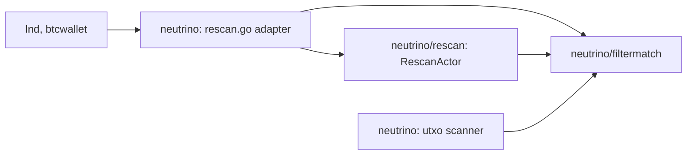
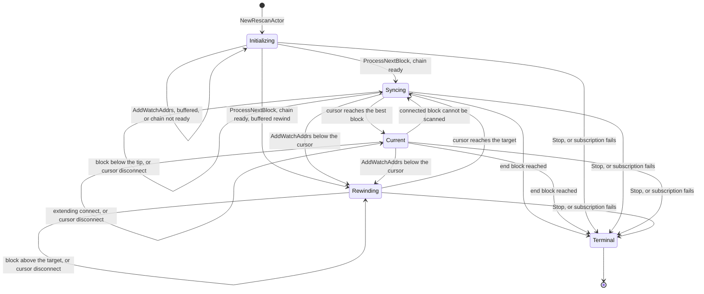

# Rescan actor

`rescan.RescanActor` scans the chain for transactions that pay a watched
address or spend a watched outpoint, and reports every scanned block to the
wallet through `Callbacks`. Its lnd actor mailbox serializes every request,
continuation and block notification. Each mailbox turn drives a `protofsm`
state machine synchronously and then dispatches the outbox events the
transition returned.

The public rescan API of the `neutrino` package, `NewRescan`, `Rescan.Start`,
`Rescan.Update` and `Rescan.WaitForShutdown`, runs on the actor. lnd and
btcwallet use that API, so the actor is the only rescan implementation.

## Packages

- **`filtermatch`** is a leaf package that imports nothing else from
  neutrino. It holds the matching that the actor, the utxo scanner and the
  root package share: `InputWithScript`, `MatchFilter`,
  `SpendsWatchedInput`, `PaysWatchedScript` and `VerifyBasicBlockFilter`.
  The root package forwards `VerifyBasicBlockFilter` to it. The root
  `InputWithScript` stays a struct of its own with the same fields, so the
  exported type keeps its identity, and the adapter converts it field for
  field.
- **`rescan`** holds the actor and its states. It does not import the root
  package. Its `ChainSource` is narrower than the root one: `GetBlock` and
  `GetCFilter` take a context, and `GetCFilter` a batch flag, in place of
  root query options, and `MarkAsConfirmed` is part of it.
- **`neutrino`** (`rescan.go`) is the adapter. It keeps every exported type,
  function and option of the legacy rescan, and maps them onto the actor.

## The public API adapter

| Public API | Actor |
| --- | --- |
| `NewRescan(chain, options...)` | Stores the options. Nothing runs yet. |
| `Rescan.Start()` | Resolves the start and end blocks and checks the options exactly as the legacy `newRescanState` did, with the same errors, then builds and starts a `RescanActor`. |
| The quit channel closes | The adapter stops the actor, waits for its last callback, and sends `ErrRescanExit`. |
| The end block is scanned | The FSM stops in Terminal, and the adapter sends nil. |
| The ChainService stops | A fetch fails with `ErrShuttingDown` or the subscription closes, whichever comes first. Either ends the FSM in Terminal, and the adapter sends `ErrShuttingDown`. |
| A header store read fails | The FSM stops in Terminal, and the adapter sends the store's error. A read that finds no header, as after a reorg rolled the store back, is retried instead. |
| `Rescan.Update(options...)` | `AddWatchAddrs` with the same addresses, inputs and `DisableDisconnectedNtfns`. A zero `Rewind` means no rewind, as before. |
| `Rescan.WaitForShutdown()` | Waits for the adapter goroutine, which ends only after the actor's `WaitForShutdown`. No handler runs once it returns. |

`rescanChain` adapts the root `ChainSource`. It turns the actor's context
into a `CancelQuery` option and its batch flag into the query options the
legacy loop used: `OptimisticBatch` for a historical filter fetch,
`NumRetries(2)` for a live one, and the caller's `QueryOptions` for a block
fetch. Its `MarkAsConfirmed` tells the broadcaster only when the chain is a
`RescanChainSource`, as the legacy loop did. The adapter retries a block it
could not fetch after 100ms, the legacy retry interval, where the actor's
default is three seconds.

The adapter maps the six notification handlers the legacy loop called onto
the actor's callbacks, which have the same signatures. For each scanned
block the order is `OnRedeemingTx` and then `OnRecvTx` for each relevant
transaction in block order, `OnFilteredBlockConnected`, then
`OnBlockConnected`. A disconnect notification reports
`OnFilteredBlockDisconnected` and then `OnBlockDisconnected`. A rewind
reports them the other way round, and not at all when its update set
`DisableDisconnectedNtfns`. The rescan never calls the other handlers.

## States

- **Initializing** holds `AddWatchAddrs` updates until the subscription
  exists, since scanning without one could miss a disconnect. It keeps each
  update's rewind below the start. It also waits for the chain, as the
  legacy loop did before its first scan: until the best block has reached
  the start block, and the chain is current or has reached the end block.
  Until then each continuation asks to be sent again after the retry
  interval, with no error.
- **Syncing** scans the block above its cursor from the header store, one
  block per continuation. It ignores connect notifications: the header store
  holds a block before its notification arrives, so a later step scans it.
- **Current** scans each block a connect notification delivers. When it
  cannot scan one, because a fetch failed or the block does not extend the
  cursor, it hands the cursor back to Syncing instead of retrying the block.
  Syncing then catches up from the header store, including any successor
  that arrived meanwhile, and does not report `OnRescanFinished` a second
  time.
- **Rewinding** walks back from the cursor to its target, one block per
  continuation, and reports a disconnect for every block above the target,
  unless the update that asked for that part of the rewind disabled it. It
  then hands the cursor to Syncing with `Scanning` as it was, as the legacy
  loop did: once the scan has passed the wallet birthday, every rescanned
  block is checked, and before that none is.
- **Terminal** ignores everything except a watch-list update, which fails
  with `ErrStopped` since it would never be scanned. `Stop` moves the rescan
  here, and so do a failed subscription and the end block.

Syncing, Current and Rewinding undo the cursor block on a disconnect
notification that names it, and ignore any other disconnect. Initializing
ignores disconnects. Every state but Terminal adds an `AddWatchAddrs` update
to its watch list.

### Batches

The actor runs up to `BatchSize` Syncing or Rewinding steps per mailbox
turn, one block each, and dispatches each block's callbacks before it takes
the next. A turn ends early, after the block in progress, as soon as an
`AddWatchAddrs` or `CurrentState` call is waiting. Current yields too: a
connect notification that reaches it while a request waits hands the scan
to Syncing, so a backlog of queued notifications cannot hold the request.
So a request waits for one block at most, the bound the legacy loop gave by reading updates between
blocks. A wallet whose handler and whose `Update` share a goroutine, as
lnd's notifier does, therefore never has more than one block's callbacks
queued behind its own blocked `Update`.

## Heights

Every state but Terminal carries a cursor: the last scanned block. Three
conventions follow from it.

- **The start block counts as already scanned.** The cursor starts at
  `StartStamp`, so the first block scanned is `StartStamp.Height+1`, as in
  the legacy rescan.
- **A rewind keeps its target block.** `AddWatchAddrs` with `RewindTo` set
  to `h` disconnects every block above `h`, from the cursor down to `h+1`,
  and then scans them again from `h+1`. A target at or above the cursor is a
  plain watch-list update.
- **The subscription backlog starts at +1.** `Subscribe(h)` delivers a connect
  for every active block above `h`. The actor subscribes at height 0, which
  asks for no backlog, before it scans anything, and catches up from the
  header store instead.

The end block is scanned: the rescan stops once the cursor matches the end
block's hash, or its height when that is set, before it scans anything
above it.

## Chain and shutdown assumptions

The actor subscribes before historical scanning and keeps that subscription
while catching up and rewinding. Disconnection notifications supply the
headers needed to undo scanned blocks, including headers removed from the
active header store. The subscription fails only once the ChainService has
stopped: if `Subscribe` fails at start, or the subscription closes while the
rescan runs, the actor reports the error once through `OnError` and stops in
`StateTerminal`, as the legacy rescan loop does. It does not resubscribe.

The caller must provide a start stamp and header on the active chain. If the
anchor was already disconnected before the subscription began, the actor
cannot recover the missing headers. It reports errors and retries rather than
reporting a completed scan. The caller must reconcile its wallet state and
restart from a known active-chain anchor when the missing ancestry cannot be
recovered.

The actor cancels its block and filter queries before waiting for the mailbox
on shutdown. The underlying ChainSource must honor the cancellation for an
in-flight fetch to return promptly. A step whose fetch Stop cancelled is not
reported through `OnError` and is not retried. Retry delays and bridge sends
are also cancelled on shutdown. `Stop` may run before, during or after
`Start`, and leaves no goroutine or subscription behind. `WaitForShutdown`
waits for the bridge, retry and continuation goroutines and for the mailbox
turn in flight. Every turn after `Stop` does nothing, so no callback starts
once `WaitForShutdown` has returned.

The P model captures early subscription and idempotent start requests. Its
historical scan still abstracts disconnect delivery and does not establish the
runtime ordering covered by the deterministic reorg tests. It predates the
adapter and the changes of this layer.

## Callbacks and errors

Every callback, and `OnError`, runs on the actor goroutine inside a mailbox
turn. A callback must not call back into the actor. A call to `AddWatchAddrs`
or `CurrentState` from a callback waits behind its own turn until its context
ends, as an `Update` from a handler deadlocked the legacy loop, and a call to
`Stop` stalls for a second.

`OnError` is for observation only. A Syncing or Rewinding step whose block
or filter fetch fails, or whose filter fails verification, is reported there
and retried by the actor after the retry interval, so a caller must not build
its own retry on it. Three errors end the rescan instead, as they ended the
legacy loop, and are reported once: a failed or closed subscription, the
`ErrShutdown` error from a fetch, and a `HeaderStoreError`. A closed
subscription means the chain shut down, so it ends the rescan with
`ErrShutdown` when that is set. The state is then `StateTerminal`, and
`Err` says which error ended it. A
later `AddWatchAddrs` returns `ErrStopped`. The adapter sets no `OnError`:
the actor logs each retried error itself, and the error channel reports only
the error that ended the rescan.

`neutrino.UseLogger` registers the rescan and filtermatch loggers with its
own, so the actor logs where the legacy loop did.

## Watch-list updates

The watch list only grows. A state's successor extends its slices and its
script index in place, so an update costs O(1) amortized however long the
list is, as with the legacy loop's appends. A state reads its slices only up
to its own lengths, and validates a script index entry against its own
script list, so a successor's appends never change what an earlier state
watches. `CurrentState` hands out a deep copy.

An `AddWatchAddrs` update with no rewind applies to future scanning only. To
cover blocks already processed or concurrent with registration, callers must
provide a prior active-chain rewind height. Scanning resumes after that anchor.

`AddWatchAddrs` and `CurrentState` take a context and have no timeout of
their own. They return once the actor has answered, which takes at most the
block in progress, or with `ErrStopped` once the rescan has stopped. If the
context ends first, the outcome is unknown: an update already queued in the
mailbox can still apply after the caller returns. The public `Update` waits
the same way, as the legacy `Update` did, and ends its wait only when the
rescan ends. A request sent before `Start` waits in the mailbox until `Start`
runs.
