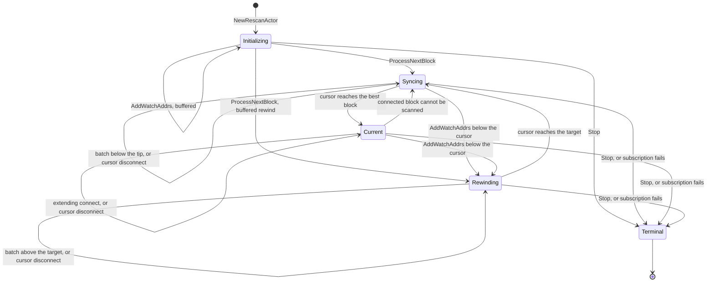

# Rescan actor

`rescan.RescanActor` scans the chain for transactions that pay a watched
address or spend a watched outpoint, and reports every scanned block to the
wallet through `Callbacks`. Its lnd actor mailbox serializes every request,
continuation and block notification. Each mailbox turn drives a `protofsm`
state machine synchronously and then dispatches the outbox events the
transition returned.

## States

- **Initializing** holds `AddWatchAddrs` updates until the subscription
  exists, since scanning without one could miss a disconnect. It keeps the
  lowest rewind target below the start.
- **Syncing** scans the blocks above its cursor from the header store, one
  batch of `BatchSize` blocks per continuation. It ignores connect
  notifications: the header store holds a block before its notification
  arrives, so the next batch scans it.
- **Current** scans each block a connect notification delivers. When it
  cannot scan one, because a fetch failed or the block does not extend the
  cursor, it hands the cursor back to Syncing instead of retrying the block.
  Syncing then catches up from the header store, including any successor
  that arrived meanwhile, and does not report `OnRescanFinished` a second
  time.
- **Rewinding** walks back from the cursor to its target, one batch per
  continuation, and reports a disconnect for every block above the target.
  It then hands the cursor to Syncing with `Scanning` set, so the rescanned
  blocks are checked even if they predate the wallet birthday.
- **Terminal** ignores everything. `Stop` moves the rescan here, and so does
  a failed subscription.

Syncing, Current and Rewinding undo the cursor block on a disconnect
notification that names it, and ignore any other disconnect. Initializing
ignores disconnects. Every state but Terminal adds an `AddWatchAddrs` update
to its watch list.

## Heights

Every state but Terminal carries a cursor: the last scanned block. Three
conventions follow from it.

- **The start block counts as already scanned.** The cursor starts at
  `StartStamp`, so the first block scanned is `StartStamp.Height+1`, as in
  the legacy rescan.
- **A rewind keeps its target block.** `AddWatchAddrs` with `rewindTo` set to
  `h` disconnects every block above `h`, from the cursor down to `h+1`, and
  then scans them again from `h+1`. A target at or above the cursor is a
  plain watch-list update.
- **The subscription backlog starts at +1.** `Subscribe(h)` delivers a connect
  for every active block above `h`. The actor subscribes at height 0, which
  asks for no backlog, before it scans anything, and catches up from the
  header store instead.

## Chain and shutdown assumptions

The actor subscribes before historical scanning and keeps that subscription
while catching up and rewinding. Disconnection notifications supply the
headers needed to undo scanned blocks, including headers removed from the
active header store. The subscription fails only once the ChainService has
stopped: if `Subscribe` fails at start, or the subscription closes while the
rescan runs, the actor reports the error once through `OnError` and stops in
`StateTerminal`, as the legacy rescan loop does. It does not resubscribe.

The caller must provide a start stamp and header on the active chain. If the
anchor was already disconnected before the subscription began, the actor
cannot recover the missing headers. It reports errors and retries rather than
reporting a completed scan. The caller must reconcile its wallet state and
restart from a known active-chain anchor when the missing ancestry cannot be
recovered.

The actor cancels its block and filter queries before waiting for the mailbox
on shutdown. The underlying ChainSource must honor the cancellation query
option for an in-flight fetch to return promptly. Retry delays and bridge sends
are also cancelled on shutdown. `Stop` may run before, during or after
`Start`, and leaves no goroutine or subscription behind. `WaitForShutdown`
waits for the bridge, retry and continuation goroutines, not for the actor
goroutine itself.

The P model captures early subscription and idempotent start requests. Its
historical scan still abstracts disconnect delivery and does not establish the
runtime ordering covered by the deterministic reorg tests.

## Callbacks and errors

Every callback, and `OnError`, runs on the actor goroutine inside a mailbox
turn. A callback must not call back into the actor. A call to `AddWatchAddrs`
or `CurrentState` from a callback waits behind its own turn until it times
out, and a call to `Stop` stalls for a second.

`OnError` is for observation only. A Syncing or Rewinding batch that fails is
reported there and retried by the actor after three seconds, so a caller must
not build its own retry on it. The one error after which the rescan stops is
a failed subscription, and the state is then `StateTerminal`.

The neutrino package does not register the rescan logger, because that would
be an import cycle. The rescan's logs are silent until the embedding program
calls `rescan.UseLogger`.

## Watch-list updates

An `AddWatchAddrs` update with no rewind applies to future scanning only. To
cover blocks already processed or concurrent with registration, callers must
provide a prior active-chain rewind height. Scanning resumes after that anchor.

`AddWatchAddrs` waits up to five seconds for an acknowledgement. A timeout does
not remove an update already queued in the mailbox: it can still apply after
the caller returns. Callers must treat a timeout as an unknown outcome and
reconcile the current watch state before assuming registration failed. The
actor does not roll back wallet state maintained by its caller. A request
sent before `Start` waits in the mailbox until `Start` runs.
