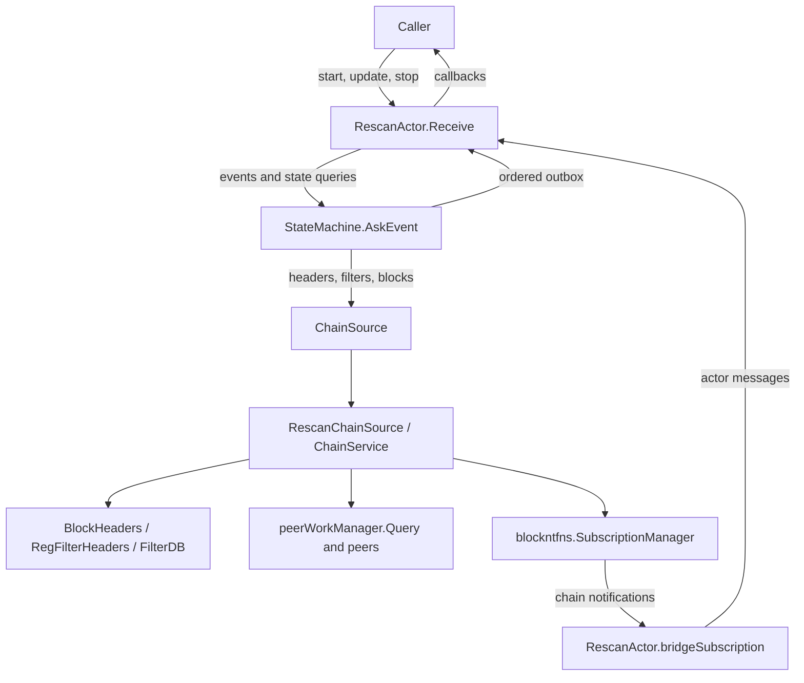
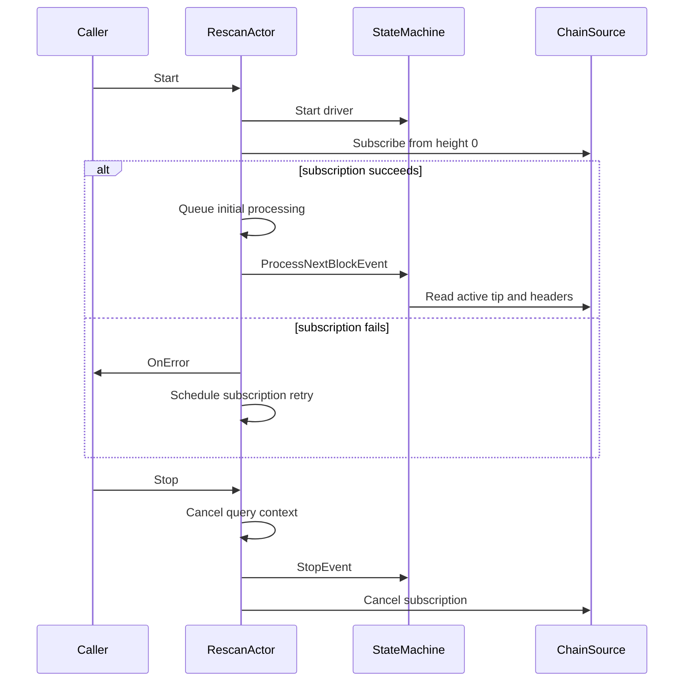
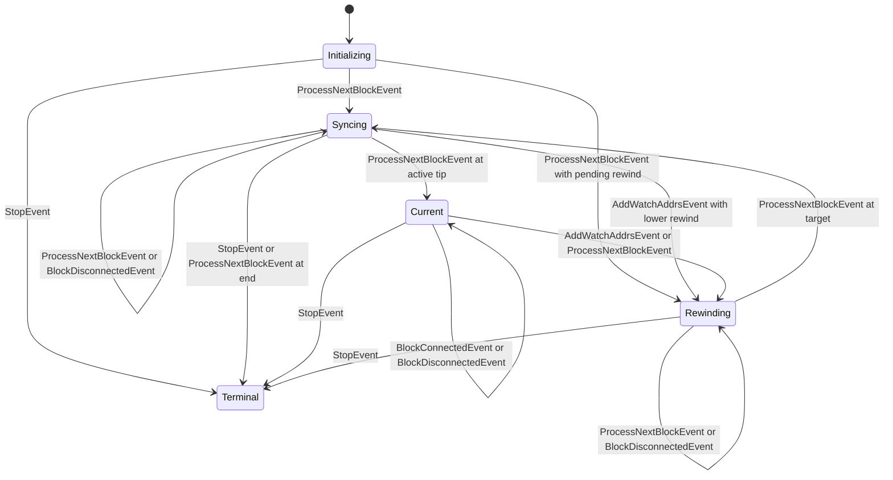
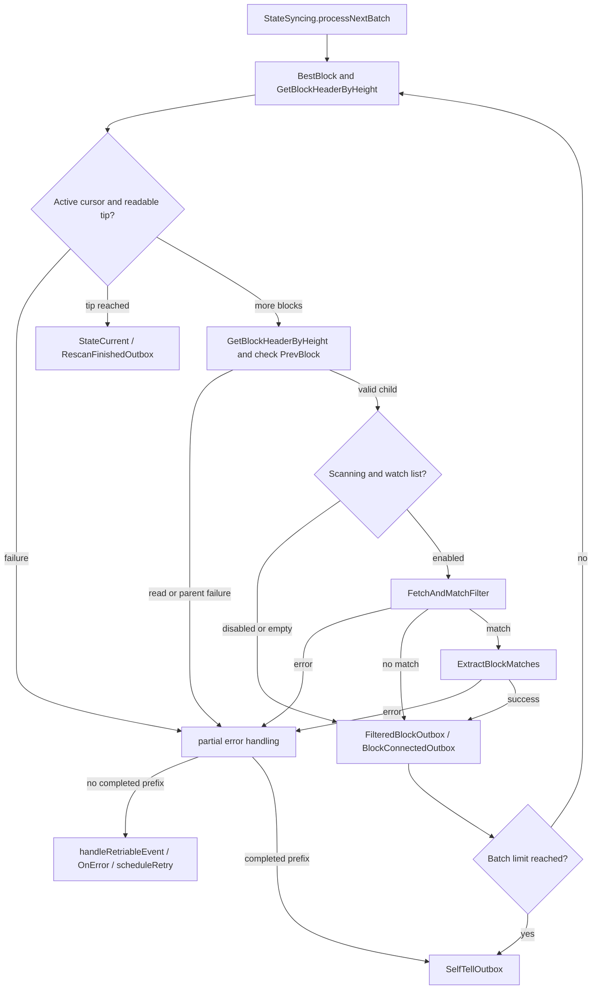
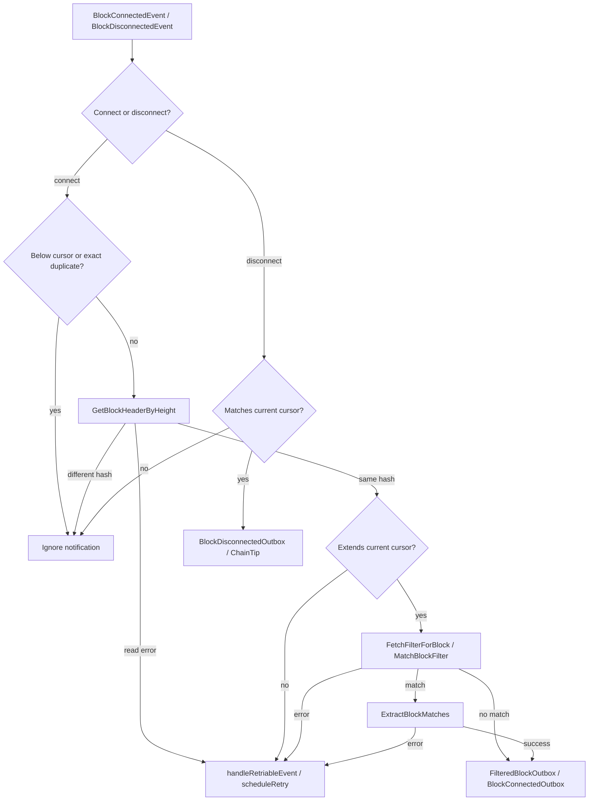
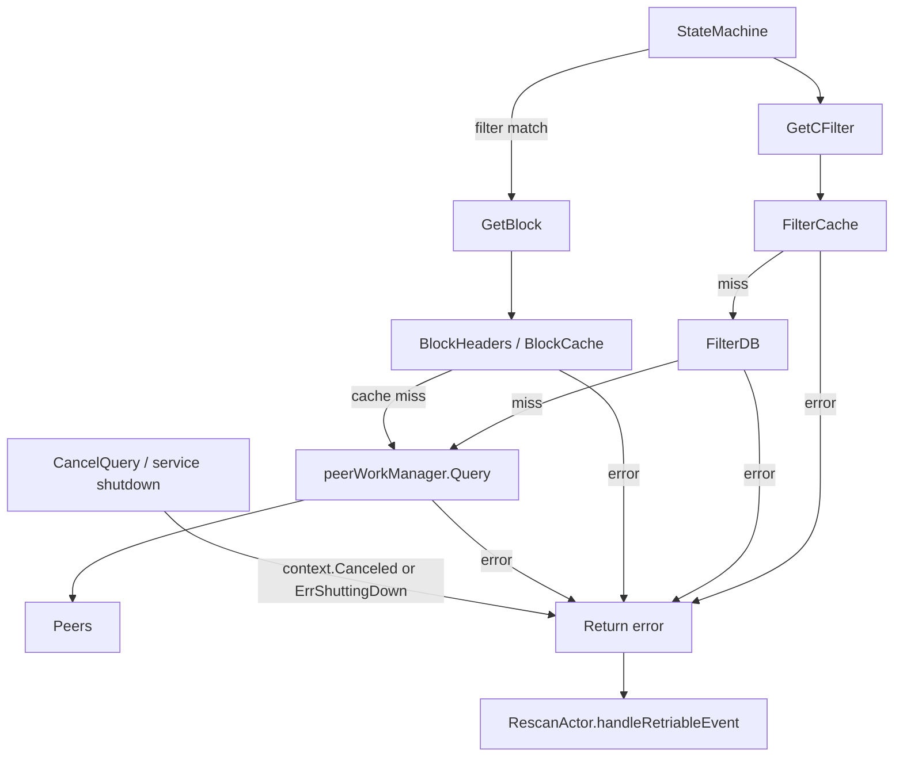
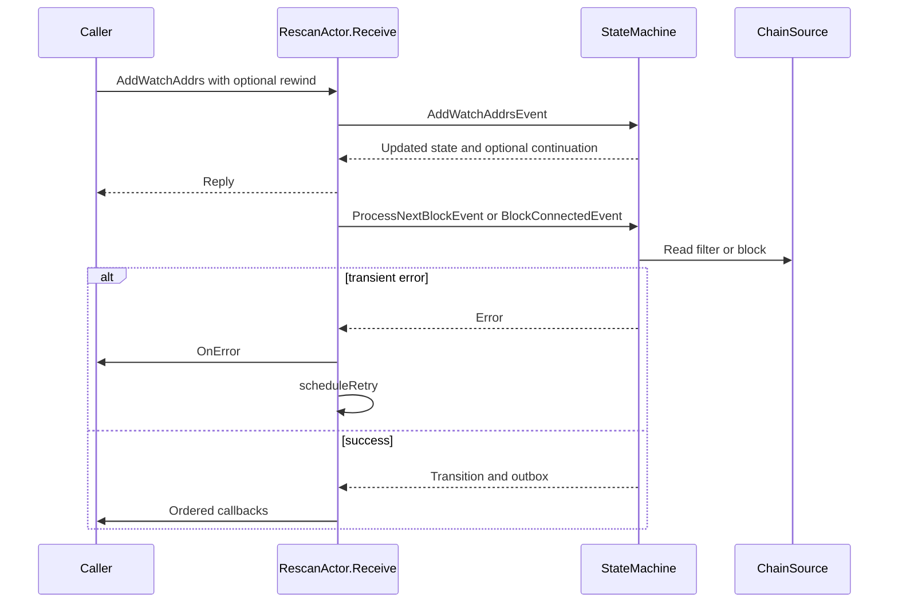

# Rescan actor architecture

This document describes the rescan actor at commit `358fa3b`. It is a guide to
the in-memory actor in `rescan/`, its chain-source boundary, and the effects
that reach a caller. The repository also has the existing `NewRescan` API in
`rescan.go`; it runs its own rescan loop and does not instantiate this actor.
The actor is exercised by its tests and the P model bridge. A wallet integrating
it must provide its own durable cursor and transaction processing.

## Components and boundaries

The actor connects a caller to the FSM, chain source, and callback outbox.

| Component | Owns | Does not own |
| --- | --- | --- |
| `RescanActor` | Mailbox processing, subscription bridge, retry scheduling and callback dispatch. | Wallet persistence or chain data. |
| `StateMachine` | The current rescan state and transitions. | Callback execution or network transport. |
| `WatchState` | Addresses, watched inputs and scripts, including the script lookup index. | Wallet account policy or durable watch registration. |
| `ChainSource` | The interface used for chain reads and subscriptions. | The underlying stores or peers. |
| `ChainService` | Chain header and filter stores, caches, subscriptions and network queries. | The caller's transaction effects and scan cursor. |

The FSM computes a transition and its ordered outbox. The actor dispatches the
outbox after the transition succeeds. A callback is therefore a delivery to the
caller, not a durable commit of the caller's wallet state. See
[`rescan/actor.go`](../rescan/actor.go), [`rescan/fsm.go`](../rescan/fsm.go),
[`rescan/filter.go`](../rescan/filter.go), and
[`neutrino.go`](../neutrino.go).

## Startup and shutdown

The first subscription precedes historical processing; shutdown cancels the
actor context before waiting for its mailbox.

1. **Construct and subscribe.** Construction copies the initial watches, creates an initializing state,
   and appends a per-query cancellation option. `Start` starts the FSM and
   establishes the subscription before asking it to scan. A failed subscription
   is reported and retried; scanning does not begin until it succeeds.
2. **Deliver events.** The bridge translates subscription notifications into actor messages. Its
   messages and caller updates enter the actor mailbox. The FSM driver owns the
   state separately and returns the resulting outbox to the actor.
3. **Stop and wait.** `Stop` cancels the actor context before waiting for its stop request. This
   cancels in-flight `ChainService` filter and block queries. Shutdown also
   cancels the subscription; `WaitForShutdown` waits for the actor's tracked
   goroutines. A different `ChainSource` implementation must honor query
   options to provide the same cancellation behavior.

The built-in network path combines the per-query cancellation signal with
service shutdown. Per-query cancellation returns `context.Canceled`, while
service shutdown returns `ErrShuttingDown`. Cache and database reads precede
network dispatch; the cancellation option applies to the query path, rather
than guaranteeing interruption of every possible local store read. See
[`query.go`](../query.go) and
[`querysync/workmanager/workmanager.go`](../querysync/workmanager/workmanager.go).

The work manager's dispatcher owns accepted query batches. `handleNewBatch`
starts each cancellation watcher, `cancelBatch` retires canceled work, and
`stopBatchTimers` releases the watcher on completion, cancellation or shutdown.
Late results for retired batches return before peer accounting. These
transitions run in the dispatcher goroutine; see
[`dispatcher.go`](../querysync/workmanager/dispatcher.go) and
[`dispatcher_result.go`](../querysync/workmanager/dispatcher_result.go).

## Rescan states

The state transitions below use the events handled by each state.

`StateInitializing` retains the earliest lower rewind requested while
subscription setup is pending. `StateSyncing` processes historical blocks in
batches, then enters `StateCurrent` when it reaches the active tip.
`StateRewinding` emits disconnects down to the requested anchor and returns to
syncing. The next scan starts *after* that anchor. `StateTerminal` remains
terminal. The FSM has an end-block facility, but `ActorConfig` does not wire an
end block into its environment; the configured-end edge applies to direct FSM
use, not the actor constructor.

A rewind can also receive a matching chain disconnect from the subscription.
The event includes the previous tip header, so that step does not need to look
up an orphaned header. Syncing handles matching disconnects as well. Other
notifications may be obsolete by the time they reach the mailbox; current-state
connect processing checks the active header at the notification's height before
accepting the block. See [`rescan/state_initializing.go`](../rescan/state_initializing.go),
[`rescan/state_syncing.go`](../rescan/state_syncing.go),
[`rescan/state_current.go`](../rescan/state_current.go), and
[`rescan/state_rewinding.go`](../rescan/state_rewinding.go).

## Scanning and matching

A historical batch validates the active cursor on each iteration. Its failure
path depends on whether the batch has already completed any blocks.

The diagram shows the historical path. A batch uses the active chain's headers
and checks that each new header extends the scan cursor. Filtering starts once
the block timestamp is strictly after the configured start time, and remains
active thereafter. A rewind resumes with scanning enabled. Historical filter
requests use the optimistic batch query option; live requests use the ordinary
query options.

A filter hit causes a full block fetch and filter verification. Matching checks
inputs for watched spends and output scripts against a per-watch script index.
Newly found outpoints become watches for subsequent transactions, including
later transactions in the same block. The state and watch set are advanced only
for successful processing. If a later block in a historical batch fails, the
completed prefix and its outbox are retained and a continuation is scheduled
without reporting that error at that point. A failure before progress is returned
to the actor, which reports it and schedules a retry. The default batch size is 100
and progress callbacks are emitted at intervals of 10,000 heights. See
[`rescan/environment.go`](../rescan/environment.go) and
[`rescan/filter.go`](../rescan/filter.go).

For each processed block, the filtered callback precedes transaction
confirmation callbacks and the block-connected callback. Disconnect delivery
calls the filtered disconnect callback before the block-disconnected callback.
These callbacks run as actor effects, so a slow callback also delays mailbox
processing.

## Live notifications and reorganizations

The current-state path validates connected notifications against the active
chain before producing effects.

This diagram describes handling while current. A subscription can deliver an
old connected notification after the chain has reorganized, even though the
notification was produced when that old block was active. The height lookup
rejects that stale hash before the actor matches its filter or emits a connect
callback. A temporary header lookup failure is retried: dropping it outright
could lose the only notification for a valid block. A failed connect retry is
also checked against the current cursor and active chain before processing.

In `StateCurrent`, a disconnect only changes the cursor when its header hash
matches the current tip. For a matching disconnect, the notification carries the parent
header and the FSM emits the disconnected header to the caller. During
historical scanning and rewind, matching disconnects can also move the cursor
back. The actor subscribes before scanning so that a reorganization during
catch-up can deliver these disconnects. The source's height-based backlog is
not a record of every previous branch; it cannot repair a gap that predates the
subscription.

## Chain queries and persistence

The chain source resolves filter and block requests through the chain service.

`RescanChainSource` exposes the chain service to the rescan through the
`ChainSource` interface. The service owns the header stores, filter database,
caches, subscription manager and query work manager. Filter requests consult
the cache and database before a network request; full block requests consult
header data and the block cache before dispatch. Network results are validated
before use. Filter persistence is controlled by the chain service's own
configuration, independent of the actor's callback delivery.

`CancelQuery` is honored by `GetBlock` and `GetCFilter`; other consumers of
`QueryOption` ignore it. If cancellation races a completed network request,
the caller can receive `context.Canceled` even when a valid response is
available. The caller receives no result in that case.

For the rest of the chain service and its stores, see
[`sync-architecture.md`](sync-architecture.md).

The rescan cursor, watch state and discovered wallet effects are in memory.
The caller must decide when to persist its own cursor and transaction effects,
and how to restore a compatible active anchor after a restart. The chain
service persisting a filter does not persist the caller's scan progress.

## Updates, retries, and ownership

Updates and retry messages share the actor mailbox with chain notifications.

A nil rewind registers watches for future processing. A caller that needs a new
watch to cover already processed or concurrently arriving blocks must provide a
prior active height as the rewind anchor. Serialization alone cannot recover a
payment processed before registration. The update and state-query calls use
five-second request deadlines. An error or timeout after a request is queued
does not prove that it was rolled back: it may still be applied when the actor
can process it. The caller must reconcile an uncertain result before assuming
its own bookkeeping matches the actor.

Failures returned through `handleRetriableEvent` are reported through
`OnError` and scheduled again after three seconds. A retry preflight can defer
an event without another error callback if its header lookup fails or its
parent is not yet ready. Retry anchors and active-header checks prevent a stale
retry or notification from advancing an obsolete branch. Historical continuations are
coalesced and sent by a tracked goroutine, rather than blocking the actor while
sending to its own bounded mailbox. See [`rescan/actor.go`](../rescan/actor.go).

| Execution context | Mutable state and responsibility |
| --- | --- |
| Actor mailbox | Processes actor messages serially, dispatches callbacks and controls continuation scheduling. |
| FSM driver | Owns the current state; processes state events and returns snapshots and outboxes. |
| Subscription bridge | Reads notifications and sends actor messages; bridge replacement is synchronized. |
| Retry and continuation goroutines | Wait or send messages; they do not directly advance FSM state. |
| Subscription manager | Serializes subscriber management and notification fanout; each subscriber has a forwarding queue. |
| Query work manager | Owns network query batches and retires accepted work on completion or cancellation. |

## Boundaries and verification

The start anchor must be on the active chain. If it was already orphaned before
subscription began, a height-only subscription cannot reconstruct the missing
branch ancestry. A subscription interruption can leave a similar gap. The actor
reports the mismatch and retries rather than claiming the scan is current; the
caller must reconcile its saved cursor and restart from an active anchor when
ancestry is unavailable. See [`rescan-actor.md`](rescan-actor.md) for the API
contract and recovery limits.

[`rescan-deterministic-testing.md`](rescan-deterministic-testing.md) describes
the deterministic actor tests, and [`p-models/README.md`](../p-models/README.md)
describes the model and bridge. The P model is an abstraction: for example, it
abstracts the watch set and assumes the birthday has passed, while the Go
implementation also checks active headers for live connections. Model checks
therefore complement, rather than replace, tests of the concrete actor and
chain source.
