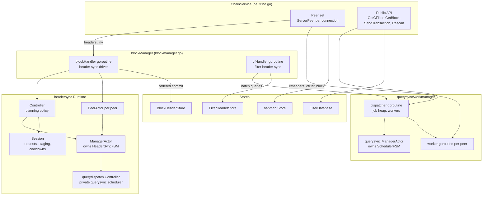
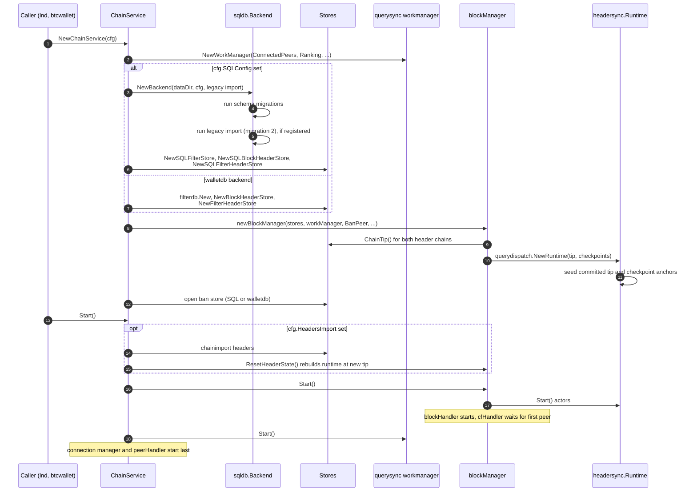
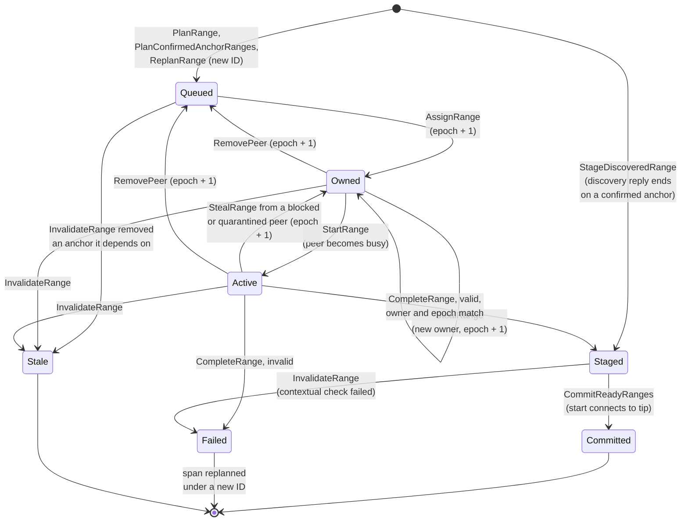
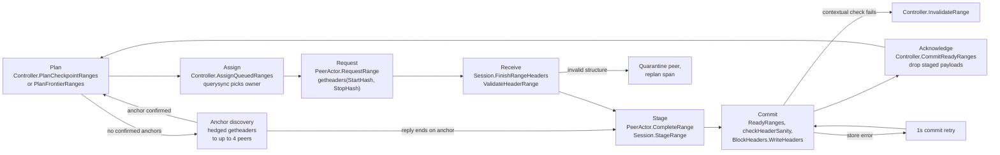
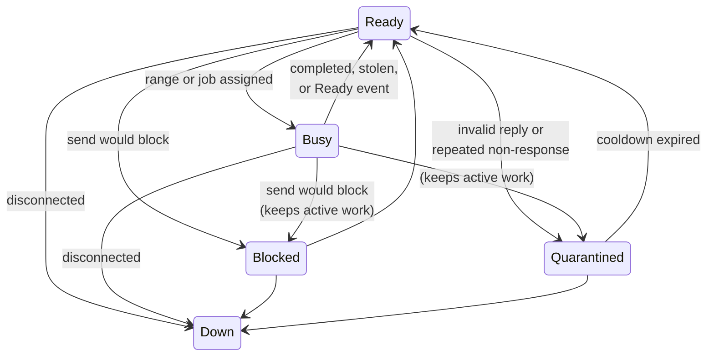
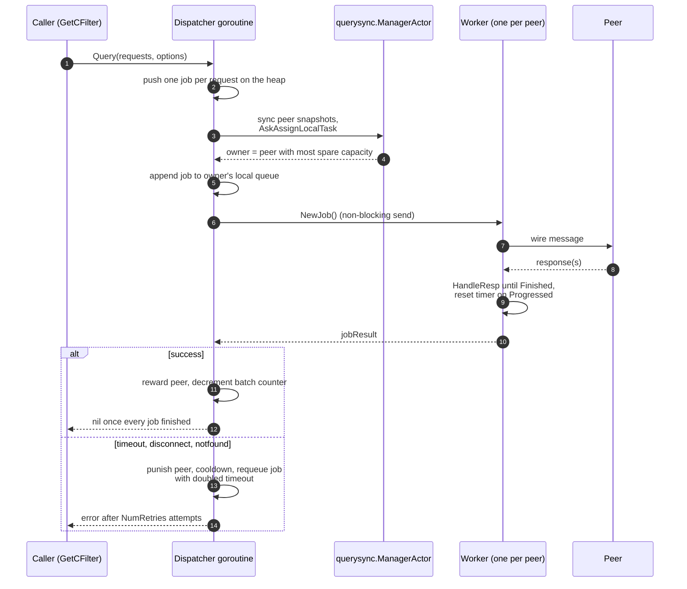
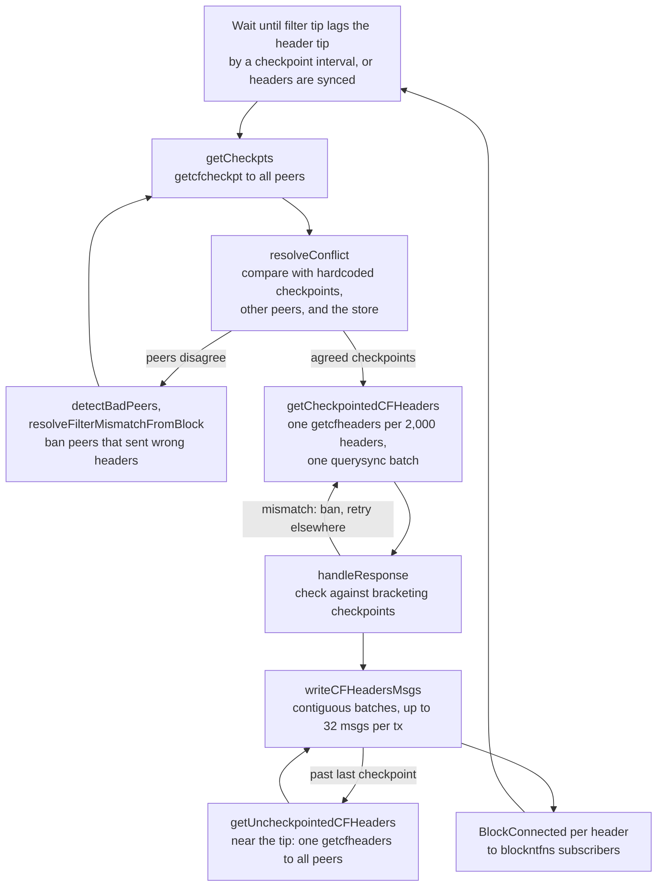
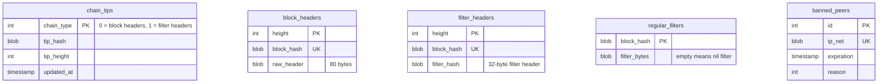
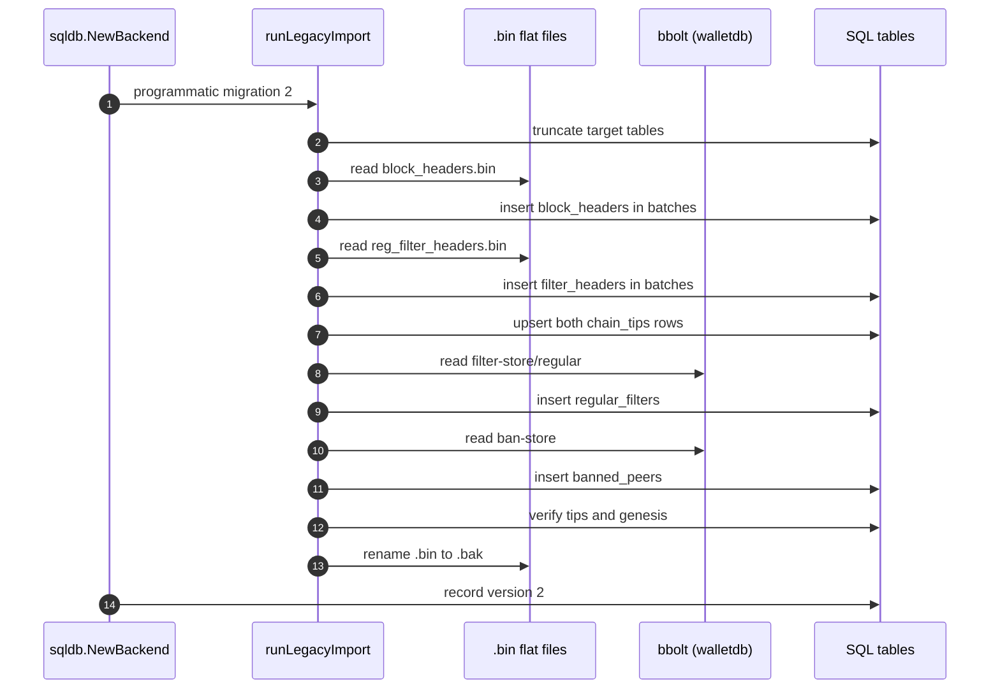

# Sync Architecture

Neutrino keeps three kinds of chain data in step with its peers: block
headers, BIP 158 filter headers, and, on demand, filters and blocks. This
document describes the components that do that work, who owns which state,
and how a request moves from the network to durable storage. It reflects the
code after the SQL and actor-based sync series (#397 through #403).

For how the sync code is tested, see
[deterministic-sync-testing.md](deterministic-sync-testing.md).

## Components

`ChainService` in `neutrino.go` is the public entry point. It owns the peer
set, the persistent stores, and two schedulers: the `blockManager`, which
drives header and filter-header sync, and the query work manager, which
serves on-demand filter and block requests.

The stores have two interchangeable backends. The legacy backend keeps block
headers and filter headers in append-only flat files indexed by a bbolt
database, and keeps filters and bans in bbolt. The SQL backend keeps all four
in one SQLite or PostgreSQL database. `NewChainService` selects the SQL
backend when `Config.SQLConfig` is set; the sync code above the store
interfaces is the same for both.

### Responsibilities

| Package or type | Owns | Does not own |
| --- | --- | --- |
| `blockManager` | Peer I/O for headers, the in-memory `headerList`, contextual header validation, ordered writes to the header stores, filter-header sync, block notifications | Range planning, lease ownership, peer scheduling policy |
| `headersync.HeaderSyncFSM` | Anchors, header ranges and their lease epochs, per-peer range queues, the committed tip known to the scheduler | Goroutines, timers, I/O, header payloads |
| `headersync.ManagerActor` | Serialized access to the FSM; mirrors peer and range changes into the dispatch controller | Policy decisions, which live in the FSM and `Controller` |
| `headersync.PeerActor` | One peer's scheduling state (ready, busy, blocked, quarantined, down), RTT, rank, and active range | The wire request itself, which `blockManager` sends |
| `headersync.Controller` | Planning policy: checkpoint and frontier ranges, anchor discovery spans, hedged peer choice, invalidation fan-out, replanning | Any state of its own |
| `headersync.Session` | In-flight range and anchor requests with their timers, stale requests, staged header payloads, peer cooldowns, range ID allocation | Range state, which lives in the FSM |
| `headersync.Runtime` | Construction and shutdown of the actor graph | Message routing; `blockManager` calls each part directly |
| `headersync/querydispatch` | Adapting a private querysync scheduler to choose range owners and steal unstarted ranges | Header validation, leases, commit order |
| `querysync/workmanager` | The production `query.WorkManager`: the job heap, per-peer workers, retries, timeouts, cooldowns, quarantine | Message encoding and response matching, which each `query.Request` supplies |
| `querysync.SchedulerFSM` | Pure peer scheduling state: per-peer snapshots, owner selection, steal selection | Concrete jobs, which the dispatcher keeps |
| `protofsm` | A generic synchronous state machine that returns outbox messages instead of sending them | Actors or goroutines |

## Startup

`NewChainService` builds the stores and schedulers in a fixed order. The
order matters because `blockManager` reads the durable tips while it
constructs the headersync runtime.

## Block header sync

Block header sync has two paths. The parallel path splits the chain into
ranges of up to 2,000 headers and downloads them from several peers at once.
The serial path asks one sync peer for headers after a block locator, one
`getheaders` round trip at a time, which is how neutrino synced before this
series.

`startSync` tries the parallel path first. `blockManager` falls back to the
serial path in three cases:

- The network is simnet or regtest (`allowSerialHeaderFallback`). Those test
  networks usually have one peer, and the parallel path needs several peers
  to confirm discovered anchors.
- The parallel path could neither plan a range nor start anchor discovery.
- The node has caught up. New blocks announced by `inv` or unsolicited
  `headers` messages go through `handleHeadersMsgWithPeers`, which also
  handles reorgs and calls `rollBackToHeight`.

### Anchors and ranges

An anchor is a height and hash that the scheduler can use as a range
boundary. Checkpoints from the chain parameters and the committed tip are
trusted anchors. Past the last checkpoint, the scheduler discovers anchors by
asking peers for headers. A discovered anchor becomes usable once
`AnchorConfirmationsRequired` peers have reported the same hash; production
uses one confirmation and asks up to four peers in parallel, so a single slow
peer does not set the pace.

A range is the half-open interval `(StartHeight, StopHeight]` between two
confirmed anchors. `StartHash` is the locator for the `getheaders` request and
`StopHash` is the hash the last header must have. The FSM tracks each range
through these states:

`AdvanceCommittedTip` also moves ranges into terminal states. When the
durable tip moves past a range without going through `CommitReadyRanges`, for
example because the serial path wrote headers, every range that ends at or
below the new tip becomes Committed and every range that straddles it becomes
Stale.

### Leases

Every range carries a `LeaseEpoch`. The FSM increments it whenever ownership
changes: on assignment, steal, requeue, discovery staging, and invalidation.
It does not change when an owned range starts. `CompleteRange` accepts a
reply only if the reply's peer, epoch, and the range's Active state all
match. A reply from a peer whose lease was revoked is reported as stale and
dropped, so a slow peer cannot overwrite the work of the peer that replaced
it.

`Session` adds the wire-level half of the lease. Each in-flight request is
identified by peer, request ID, range ID, and epoch, and its timeout timer
fires only if that identity still matches. A request that timed out is kept
as a `StaleRequest` until it expires, so a late reply is consumed there
instead of being treated as an unsolicited `headers` message.

### From plan to durable commit

1. **Plan.** `continueHeaderSync` calls `Controller.PlanCheckpointRanges`
   while a checkpoint lies ahead and `PlanFrontierRanges` after the last
   checkpoint. Both first reconcile the FSM with the durable tip through
   `AdvanceCommittedTip`, then create Queued ranges between adjacent
   confirmed anchors.
2. **Discover.** If no range can be planned and the remaining span exceeds
   one range, the controller picks a discovery span starting at the furthest
   confirmed anchor and asks up to four peers for it. A reply that is
   structurally valid confirms its last header as an anchor. If the reply
   also ends on a confirmed anchor, its headers are staged directly.
3. **Assign and request.** `AssignQueuedRanges` hands out up to four ranges
   per peer. The private querysync scheduler chooses the owner. When a peer
   is idle, its `PeerActor` starts its next owned range and `blockManager`
   sends `getheaders` with the range's start hash as the locator and its stop
   hash as the stop hash. An idle peer with no owned ranges asks to steal
   unstarted work from a slower peer.
4. **Receive.** `ValidateHeaderRange` checks only structure: the first
   header connects to `StartHash`, the headers connect to each other, and the
   last header is `StopHash`. A peer that fails this check is quarantined and
   its span is replanned.
5. **Stage.** A valid range becomes Staged and its headers go into
   `Session`. Ranges can be staged out of order, because peers answer at
   different speeds.
6. **Commit.** `commitReadyHeaderSyncRanges` takes the chain of Staged ranges
   that connects to the committed tip, runs the contextual checks in
   `checkHeaderSanity` (proof of work, difficulty, timestamps, checkpoints),
   and writes them to `BlockHeaderStore` in one batch. Only this step makes
   headers visible to the rest of neutrino.
7. **Acknowledge.** `Controller.CommitReadyRanges` advances the FSM tip,
   prunes anchor requests at or below it, and the staged payloads are
   deleted.

If a staged range fails the contextual checks, `InvalidateRange` marks it
Failed. Every untrusted anchor between that range and the next trusted
anchor is deleted, every range that depends on one of those anchors becomes
Stale, and the peers holding revoked leases are told to drop them. Trusted
checkpoints, the committed tip, and work beyond the next checkpoint are
unaffected. If the store write fails instead, the staged ranges are kept and
a one-second timer retries the commit, so a recovered store does not need
another network reply to drain staging.

### Peer scheduling states

Both headersync and querysync model a peer with the same five states.

Work held by a Blocked or Quarantined peer can be stolen even after it has
started. Work held by a Ready or Busy peer can be stolen only before it
starts.

## On-demand queries

`GetCFilter` and `GetBlock`, and therefore rescans, send their requests
through `ChainService.workManager`, which is the querysync work manager. A
caller submits a batch of `query.Request` values and waits on an error
channel. Each request carries its own wire message and a `HandleResp`
function that matches responses and reports progress.

The dispatcher goroutine owns all concrete jobs and one `activeWorker` per
peer. A worker runs one job at a time. Each peer can hold at most four jobs,
counting its active job and its local queue. The owner for a new job is the
peer with the most spare capacity, with ties broken by lower load, then
better rank, lower RTT, and peer ID. The per-attempt timeout is eight times
the peer's last RTT, clamped between 2 and 32 seconds.

When a peer runs out of local work, it steals from another peer. Blocked and
quarantined peers are drained first and lose all their queued work. Ready and
busy peers with more than one queued job come next and keep one. The thief
takes as many jobs as it has spare capacity for, from the front of the
donor's queue.

A failed attempt puts the peer in a 30-second cooldown and lowers its rank.
On the third timeout or disconnect, the peer is quarantined for ten minutes
and reported through `OnPeerUnresponsive`, which bans it.

Transaction broadcast and the all-peer filter-header checks still use
`ChainService.queryAllPeers`, a broadcast loop that predates querysync.

## Filter header sync

The `cfHandler` goroutine syncs regular filter headers behind the block
header tip. Block header commits wake it: both header writers set
`headerTip` under `newHeadersMtx` and broadcast `newHeadersSignal`.

1. **Checkpoints.** `getCheckpts` asks every peer for its filter-header
   checkpoints (`getcfcheckpt`). `resolveConflict` compares them with the
   hardcoded checkpoints, with each other, and with what is already stored.
   When peers disagree, the conflicting filter headers are fetched, and the
   filter and block are fetched if needed to decide which headers are
   correct. Peers that sent incorrect headers are banned.
2. **Checkpointed range.** `getCheckpointedCFHeaders` builds one
   `getcfheaders` request per 2,000 headers and submits the whole set as one
   querysync batch. Each response is checked against the two checkpoints that
   bracket it; a peer whose response does not match is banned and the request
   is retried with another peer. Responses can arrive out of order, so
   verified responses are buffered and written in contiguous batches.
3. **Past the last checkpoint.** `getUncheckpointedCFHeaders` sends one
   `getcfheaders` to every peer and collects replies for two seconds or until
   every peer has answered. Waiting for all peers keeps a fast majority from
   hiding a timely conflicting reply. Peers whose reply does not connect to
   the stored filter header are banned, per-height mismatches are settled by
   fetching the filter and block, and the longest surviving reply is written.

### Notifications

`writeCFHeadersMsgs` is the only producer of `BlockConnected` notifications.
After each filter-header write it advances `filterHeaderTip` and sends one
`BlockConnected` per header. A block is therefore reported as connected only
once its filter header is durable. `rollBackToHeight`, which runs on
`blockHandler` during a reorg, sends `BlockDisconnected` for each block it
removes. `blockntfns.SubscriptionManager` fans both out to subscribers and
uses `NotificationsSinceHeight` to replay a backlog, bounded by
`filterHeaderTip`.

## Storage

Four store interfaces sit between the sync code and disk:
`headerfs.BlockHeaderStore`, `headerfs.FilterHeaderStore`,
`filterdb.FilterDatabase`, and `banman.Store`. Each has a legacy
implementation and a SQL implementation.

| Interface | Legacy (`Config.Database`) | SQL (`Config.SQLConfig`) |
| --- | --- | --- |
| `BlockHeaderStore` | `block_headers.bin` flat file, bbolt hash index | `headerfs.SQLBlockHeaderStore`, table `block_headers` |
| `FilterHeaderStore` | `reg_filter_headers.bin` flat file, bbolt hash index | `headerfs.SQLFilterHeaderStore`, table `filter_headers` |
| `FilterDatabase` | bbolt bucket `filter-store/regular` | `filterdb.SQLFilterStore`, table `regular_filters` |
| `banman.Store` | bbolt bucket `ban-store` | `banman.SQLBanStore`, table `banned_peers` |

### SQL schema

The two header chains have no foreign key between them because they advance
independently: the filter-header tip trails the block-header tip during sync.
Each write updates its data rows and the matching `chain_tips` row in one
transaction, so the stored tip always agrees with the stored rows.

`sqldb.NewBackend` opens one SQLite file (`<DataDir>/neutrino.sqlite`) or one
PostgreSQL connection, runs the schema migrations recorded in
`neutrino_migrations`, and builds one transaction executor per domain:
headers, filters, and bans. The two header stores share the header executor.
On SQLite, a `WriteHeaders` call of about 2,000 headers becomes 32-row
multi-value inserts inside one transaction. The SQLite profile uses WAL with
`synchronous=NORMAL`; a power loss can drop the most recent commits, which
neutrino tolerates because headers can be downloaded again.

`SQLBlockHeaderStore` keeps an 8,192-entry read cache. A miss in
`FetchHeaderByHeight` reads the next 2,048 headers in one query and caches
them, which serves the sequential reads of rescans and filter-header sync.
`RollbackBlockHeaders` clears the cache after its transaction commits, while
holding the store's write lock, so no reader sees a rolled-back header.

### Importing legacy data

When the caller supplies `Config.LegacyImport`, migration version 2 copies
the legacy data into SQL:

The import truncates its target tables first, so a run that returns an error
can be retried from scratch. The bbolt database is opened read-only and left
in place.

## Concurrency

Each piece of mutable sync state has one owner goroutine.

| Goroutine | Owns |
| --- | --- |
| `blockHandler` | `headerList`, `Session`, the sync peer, header request timers; it is the only caller of the headersync actors |
| headersync manager actor | `HeaderSyncFSM` |
| headersync peer actor, one per peer | That peer's scheduling state |
| querysync actor inside headersync | The private dispatch `SchedulerFSM` |
| `cfHandler` | Filter-header sync progress |
| querysync dispatcher | The job heap, batches, `activeWorker` map |
| querysync manager actor | The query `SchedulerFSM` |
| query worker, one per peer | The job it is running |

Timers created with `time.AfterFunc` for range timeouts, anchor timeouts,
commit retries, and the bootstrap delay only post a message to
`blockHandler`. They never touch sync state directly.

Every actor ask from `blockHandler` uses a five-second deadline. An actor
can apply a message and then report a deadline error, because the actor
runs `Receive` under its own context. Code that calls an actor must not
assume that an error means the FSM is unchanged.
